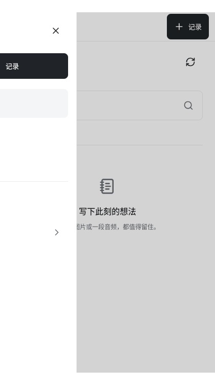
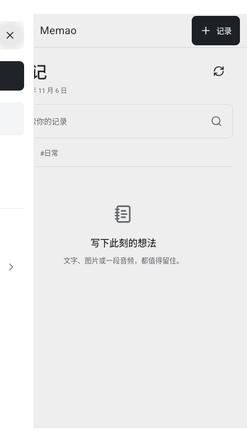
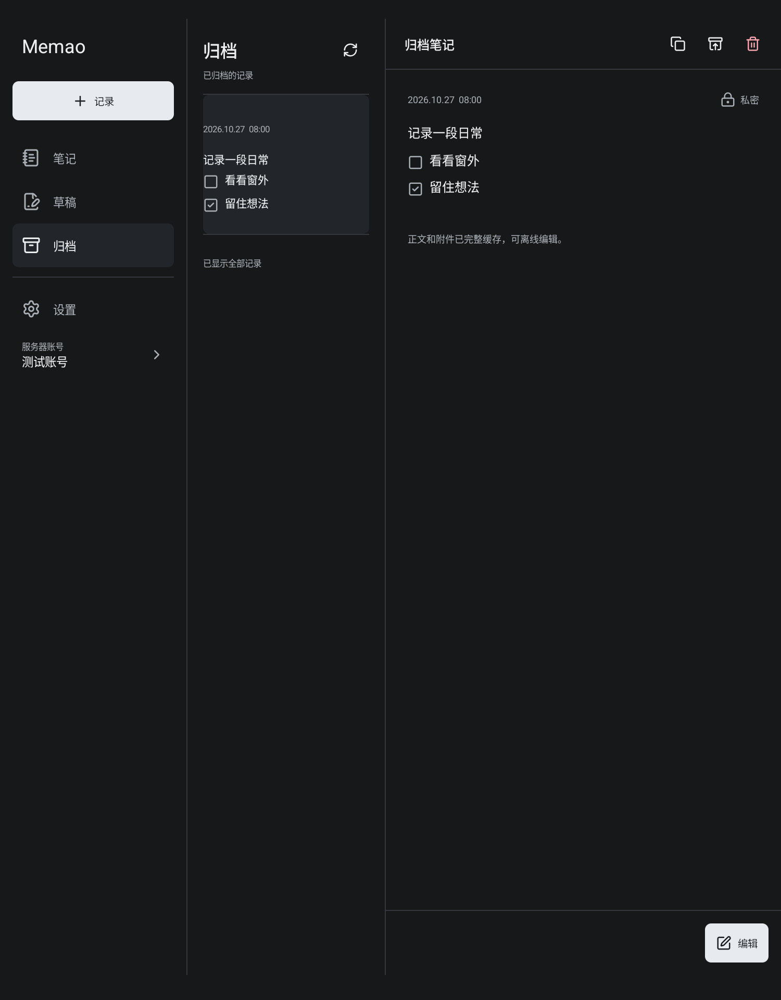

# Memao 首版开发准备与接口核对

> 本文保留各版本验收证据。当前检出与实机反馈见 [项目上下文索引](README.md#版本与验收状态)，0.1.17 输入框专项见 [I31](development-issues.md#i31-登录输入框光标偏上)。下文 APK 名称和构建路径记录当时的交付产物。

## 笔记列表布局与编辑过渡 · 0.1.21

2026-11-15，按用户反馈移除笔记列表顶部的日期、留白和分割线，缩小笔记行及展开／收起控件的布局高度，取消长按编辑前使列表位移的提示。版本升至 0.1.21（versionCode 22）。详见 [I37](development-issues.md#i37-笔记页列表布局与编辑过渡)。

- Debug、仪器测试与本地未签名优化 Release APK 构建通过。已从 Release APK 核对包名、`versionName` 和 `versionCode`。JVM 测试 46 项通过，7 项需要隔离 Memos 实例的用例跳过。
- Android 17 模拟器通过 27 项仪器检查，覆盖窄宽窗口的首条列表项、展开／收起触摸、延迟编辑准备时列表和正文坐标保持、系统返回取消，以及页面滚动、草稿和独立搜索回归。主 Agent 检查了首页及正文折叠、展开截图。本轮界面测试使用隔离 Room 和测试网关，Find N6／ColorOS 实机待验证。

## 独立搜索页 · R75

2026-11-15，按用户要求为 0.1.20（versionCode 21）加入独立搜索页。笔记页右上角打开搜索，固定输入框右侧的「取消」返回原列表。空输入展示当前账号的最近搜索，键盘搜索键、输入框放大镜和历史项可发起检索。搜索自行维护结果、分页和滚动状态，沿用标签交集、服务端筛选及离线缓存回退。历史保存在设备端，详见 [R75](planning.md#r75-独立搜索页与最近搜索)。

- Debug、仪器测试与本地未签名优化 Release APK 构建成功，核对了 APK 包名及两个版本字段。JVM 测试 46 项通过，7 项需隔离 Memos 实例的用例跳过。编译调整见 [I36](development-issues.md#i36-搜索输入状态的-jvm-签名冲突)。
- Android 17 模拟器通过 29 项不同的仪器检查，覆盖搜索按钮和键盘提交、无标签与同名标签、历史按账号持久化、离线匹配、独立分页、取消后保留滚动及迟到请求隔离，以及抽屉和启动导航回归。空搜索结果下拉刷新手势已专项复验。复核了笔记入口、窄屏历史和匹配结果、离线提示、宽屏深色空态五张截图。本轮使用隔离 Room 和测试网关，Find N6／ColorOS 实机体验待验证。

## 品牌图标 · R74

2026-11-15，按用户选定的 [B「折纸 M」](assets/design/launcher-icons/b-folded-m.png)重绘双灰矢量标志。桌面普通、圆形及主题图标共用标志轮廓与自适应安全区。项目最低支持 API 34，早期 Android 使用的固定尺寸位图已移除。[Android 自适应图标规范](https://developer.android.com/develop/ui/compose/system/icon_design_adaptive)

应用内的导航抽屉和设置页品牌标题共用标志与浅灰底色。浅灰圆角图标分别为 28 dp 和 24 dp，按既有授权确定尺寸与间距。辅助功能沿用「Memao」标题文字。验收覆盖桌面系统遮罩、抽屉窄宽布局，以及设置页深浅色的图标对齐和显示。

- Debug 主包和仪器测试包构建成功，JVM 46 项通过、7 项依赖隔离 Memos 实例的用例跳过。APK 内核对了普通、圆形与主题图标的资源引用。
- Android 17 模拟器在桌面与系统应用详情显示新的折纸 M。导航抽屉和设置页共 18 项仪器检查通过，主 Agent 复核了窄屏抽屉及深浅色设置品牌标题。宽屏夹具使用 160 dpi 验收密度，见 [I35](development-issues.md#i35-品牌图标宽屏验收夹具被裁切)。[模拟器截图](assets/acceptance/memao-brand-r74.png)
- 2026-11-15 将该更新纳入 0.1.19（versionCode 20）。本地优化 Release 构建通过，APK 内包名及两个版本字段与构建配置一致。
- Find N6／ColorOS 实机的桌面裁切与主题图标效果待验证。

## 应用内更新

2026-11-14 R73 在 0.1.18（versionCode 19）加入应用内更新。入口为「设置 → Memao」。APK 与同版本的更新清单一同发布到对应的 GitHub Release，沿用官方签名密钥。工作流验签并核对 APK 实际包名和版本，在清单中记录 `versionCode`、`versionName`、`fileName`、`size` 与 `sha256`。

- 检查使用公开 GitHub HTTPS 发布列表，从版本标签及发布说明读取版本，选择最高的 `versionCode`。清单和 APK 使用同一个版本的下载地址。下载前核对发布资产，下载后校验大小、SHA-256、APK 包名、版本及已安装应用的签名。应用私有缓存供本次下载与重试使用。安装由 Android PackageInstaller 确认，取消确认后可重新安装。
- 本地 Debug、仪器测试 APK 及未签名优化 Release 构建成功。JVM 45 项通过，7 项依赖隔离 Memos 服务的用例跳过。Android 17 模拟器设置专项 8 项通过。工作流 YAML、Bash 语法及签名测试包的清单生成已验证。
- Android 16 AOSP 模拟器使用仅监听本机的发布夹具和同一调试签名的两版测试包，走完 0.1.18（19）检查、下载、校验、首次授权、Android 确认和覆盖安装。重开后系统和设置均显示 0.1.19（20），原账号和安装前创建的未发送草稿仍可见。再次检查同一版本显示「已是最新版本」。Android 17 Play Store 模拟器另验证了系统取消后可直接重试，环境差异见 [I33](development-issues.md#i33-模拟器覆盖安装验收环境)。
- 正式 GitHub Actions 签名发布和 Find N6／ColorOS 体验待验证。公开的 0.1.17 没有更新入口，首次使用需从侧载渠道手动覆盖安装 0.1.18；后续更高版本可在 APP 内检查。

## 侧载发布条件

2026-11-14 按用户要求，[侧载工作流](../.github/workflows/sideload-release.yml) 为每个版本创建独立的 GitHub 预发布。以 0.1.18 为例，标签为 `v0.1.18`，标题为「Memao 0.1.18」，资产为 `Memao-0.1.18-release.apk` 和 `Memao-0.1.18-update.json`。发布说明中的独立一行 `versionCode: 19` 用于应用内发现更新。版本历史见 [GitHub Releases](https://github.com/christolan/Memao/releases)。

向 `main` 推送时比较推送前后的 `versionName` 和 `versionCode`，任一变化触发构建。`main` 首次推送和从 `main` 手动运行也可以发布。发布任务串行执行。同版本重跑保留已发布的标签和文件。新版本同时递增 `versionName` 和 `versionCode`。标签指向 APK 实际构建的提交，`main` 快进到其他版本后仍可发布排队的旧版本。

历史 `sideload-latest` 预发布保留原内容，新版本可在 Releases 列表找到。本地验证了不同版本各自发布、同版本重跑、标签冲突和已签名测试 APK 的清单生成。应用内更新专项 6 项通过，完整 JVM 测试 46 项通过、7 项依赖隔离服务的用例跳过。GitHub Actions 正式签名构建和首次版本化发布待推送后验证。

## 0.1.16 优化包启动修复与侧载发布

2026-11-09 官方签名且开启优化的 0.1.15（versionCode 16）在 Find N6 上打开即退出；同一 0.1.15、官方签名但关闭优化（`optimization.enable = false`）的诊断包约 31 MB，正式优化包约 8.6 MB。用户随后安装官方 Actions 侧载 APK，反馈崩溃“又回来了”。对崩溃正式包的打包检查：签名校验通过，16KB 对齐看起来正常，`debuggable=false`。

原因与修复见 [Memao 开发问题记录](development-issues.md) I30：R8 把 `kotlin.text.StringsKt__StringNumberConversionsJVMKt` 重打包为未命名包中的 `z52`，父类仍为包内可见的 `kotlin.text.k`，在 `androidx.startup.InitializationProvider.onCreate` 抛出 `IllegalAccessError`。正式包增加 `app/src/main/keepRules/release-startup.keep` 中的 `-dontrepackage`，保留收缩和包内重命名。改动已合并：[Fix optimized release crash on launch](https://github.com/christolan/Memao/pull/3)，提交 [34b66ad89ec7d22e1de2faf92286608a58f4eb21](https://github.com/christolan/Memao/commit/34b66ad89ec7d22e1de2faf92286608a58f4eb21)，约 10:16（Asia/Shanghai）。版本为 0.1.16（versionCode 17），用同一官方签名覆盖安装 0.1.15。

验证：Android 16（API 36）ATD 模拟器上，未修复的优化包在 `InitializationProvider` 以 `IllegalAccessError`（`kotlin.text.k` 被子类 `z52` 跨包继承）立即退出。加入 `-dontrepackage` 的 0.1.16 优化包冷启动进入登录页，无障碍树包含“连接你的 Memos”、服务器地址、访问令牌和“连接服务器”，日志有 ExoPlayer 初始化，崩溃缓冲区为空，进程保持。包体约 8.2 MB。Debug 单元测试：47 项运行、0 失败、7 项跳过（需要隔离 Memos 服务器）。以上为当时的模拟器结果。后续用户报告 0.1.16 可在 Find N6／ColorOS 启动，登录输入框偏上另见 [I31](development-issues.md#i31-登录输入框光标偏上)。合并后新的侧载构建见 [Actions run 42550061724](https://github.com/christolan/Memao/actions/runs/42550061724)（截至约 10:17 Asia/Shanghai 仍在进行）；成功后下载应为 [sideload-latest](https://github.com/christolan/Memao/releases/tag/sideload-latest) 的 `Memao-0.1.16-release.apk`。

侧载发布决策：用户明确目前只需要侧载，暂不考虑上 Google Play；已选择 GitHub Actions 官方签名，而不是 Play App Signing。向 `main` 推送后，工作流 `.github/workflows/sideload-release.yml`（“Sideload release”）自动构建签名 release APK，并发布到移动预发布标签 `sideload-latest`。工作流也支持 `workflow_dispatch`，只在 ref 为 `main` 时运行。本地签名可选：仅当 `MEMAO_STORE_FILE` 指向已存在的文件，且设置了 `MEMAO_STORE_PASSWORD`／`MEMAO_KEY_ALIAS`／`MEMAO_KEY_PASSWORD` 时生效；未签名 `assembleRelease` 在没有这些环境变量时仍可工作。CI 所需仓库 secret 名称：`MEMAO_KEYSTORE_BASE64`、`MEMAO_STORE_PASSWORD`、`MEMAO_KEY_ALIAS`、`MEMAO_KEY_PASSWORD`；用户已确认添加。密钥库不在仓库中，`.gitignore` 包含 `*.jks` 和 `*.keystore`。CI 在 runner 临时目录解码、构建、拒绝未签名包、执行 `apksigner verify`、发布后删除已解码密钥库。不得把密码、token、密钥库内容或 secret 值写入文档、仓库或日志。Find N6 已安装用现有官方密钥签名的版本，不得更换密钥。

[PR #1](https://github.com/christolan/Memao/pull/1)（提交 [e2fef340beef5b6dcff18aa483255c49a1c87975](https://github.com/christolan/Memao/commit/e2fef340beef5b6dcff18aa483255c49a1c87975)，约 08:56 Asia/Shanghai）已合并，首次 Actions 运行 [42542916028](https://github.com/christolan/Memao/actions/runs/42542916028) 成功。[PR #2](https://github.com/christolan/Memao/pull/2)（提交 [2c9b6fd39dea2018db9353a08a2be0ace010dd84](https://github.com/christolan/Memao/commit/2c9b6fd39dea2018db9353a08a2be0ace010dd84)，约 09:15 Asia/Shanghai）已将发布产物从 ZIP 改为直接 APK（`Memao-<versionName>-release.apk`，artifact 的 `archive: false`）；对应运行 [42544614471](https://github.com/christolan/Memao/actions/runs/42544614471) 成功，用户确认发布文件已变成 APK。

## 无标签筛选 · 0.1.15

2026-11-08 R72：用户明确要求标签筛选增加“无标签”。子 Agent 负责界面、筛选状态、缓存和协议实现及专项测试，主 Agent 负责服务端核对、集成验收与交付。

验收目标：侧栏“全部”后固定出现“无标签”；只匹配当前账号个人未归档笔记中 tags 为空的记录，与关键词取交集；与普通标签互斥并保留关键词，区分真实 #无标签；刷新、分页、切页和按账号 SavedState 恢复正确；离线只查缓存且保留范围提示；空结果正确。归档不增加筛选。

已核对固定 0.31.0 官方 [筛选说明](https://github.com/usememos/memos/blob/v0.31.0/filter/README.md) 与 [SQL 渲染](https://github.com/usememos/memos/blob/v0.31.0/filter/render.go#L879-L887)，使用 size(tags) == 0，缺失标签字段通过 COALESCE 按空集合处理。新建仅监听 127.0.0.1 的隔离实例验证，凭据只在受限临时文件；不访问用户正式服务器执行测试。实现与验收已完成，结果如下。

### 主 Agent 验收

- assembleDebug、assembleDebugAndroidTest、testDebugUnitTest 构建通过，git diff --check 通过。47 项 JVM 全部通过、无跳过，其中包含 7 项真实隔离 Memos 0.31.0 联调；新专项验证无标签＋关键词、两页结果、真实 #无标签 与普通标签区分、归档排除、空结果，以及添加／移除最后一个标签后查询成员即时变化。
- 本轮 20 项不同仪器检查全部取得通过证据：UntaggedFilter 4、IndependentPages 6、AdaptiveDrawer 10。首轮 18 通过、2 项测试夹具／旧滚动键适配失败；修正后 4 项新专项＋旧滚动回归共 5 项在 18.207 秒全部通过，重复通过不重复计数。合计 67 项不同自动化检查通过。测试适配原因见问题记录 I29。
- 无标签专项经过实际 MemaoApp、ViewModel、隔离 Room／Repository：选项互斥与反选、保留关键词、分页刷新、切页不重刷、按账号隔离、关闭旧数据库后重开恢复、离线缓存、没有普通标签时入口仍在、空结果显示均通过。
- 主 Agent 复核最终 4 张截图：窄屏侧栏仅背景高亮且与 #无标签 区分；标题显示“笔记 无标签”；宽屏深色空态正常；离线有缓存范围提示且搜索结果正确。420dp／1000dp fixture 不等同于实体折叠验收。
- 模拟器临时密度 160 用于完整宽屏截图，结束已恢复本轮启动时 1080×2400／420dpi，移除测试工具包并关闭模拟器。隔离 Memos 已停止，临时凭据文件已删除。

### 手机交付

沿用既有授权，已保留数据覆盖安装 PLP110／Android 17：versionName 0.1.15、versionCode 16，lastUpdateTime 2026-11-08 22:04:11。首次启动提示已有任务置前，随后明确冷启动复验 Status: ok、LaunchState: COLD、Complete，TotalTime 468ms、WaitTime 471ms。未卸载或清除手机数据；手机实际筛选操作与实体折叠体验待用户试用。

APK 40,434,555 字节；SHA-256：`1c23ca16ff48d0771e188e6b1c5c22a4c8cb42f6464686fabea436337fa4a372`。源码已按用户 commit & push 要求提交并推送至 origin/main：[e1e548e0c5bbf939b9f9a6754dedde55cf83bc03](https://github.com/christolan/Memao/commit/e1e548e0c5bbf939b9f9a6754dedde55cf83bc03)（feat: add untagged note filtering）。13 个文件、391 行新增与 24 行删除，main 从 8bcc590 正常快进至 e1e548e；HEAD、origin/main 与远端 main 一致，工作区干净。沿用上述 67 项不同自动化检查及手机交付证据，暂存差异检查通过；本次未改变代码或重复运行测试。

`build/qa/untagged-filter/Memao-0.1.15-debug.apk`

同目录保留构建日志、首轮与最终 instrumentation 结果、jvm-results、phone-launch.txt、截图归档和 files/qa/untagged-\*.png。交付 APK 与最终主包哈希一致。

## 设置页清晰化 · 0.1.14

2026-11-08 用户认可新方案并要求完成落地（R71）。子 Agent 分别负责设置 UI、缓存状态控制与专项测试，主 Agent 集成、审查、执行验收及手机交付。方案来源：[Memao 配套页面与异常状态设计](supporting-ui-design.md)。

### 实施结果

- 外观改为有明确边界的三段单选，选中实底反色及勾；按真实文本宽度在窄屏／大字体切为纵排，主题立即生效并持久保存。
- 账号管理为浅灰整行导航与右箭头；缓存与受保护草稿及附件为只读统计；清理使用独立描边按钮及保护说明。内容单列最大 640 dp，保留固定顶部栏、现有抽屉和黑白灰视觉。
- 缓存未知时显示读取中，读取失败可重试；清理中禁重复触发，成功使用 Repository 实际返回统计，失败保留已知占用并可重试，确实为零才禁用。旧读取不能覆盖清理结果；切账号时全账号清理继续，旧会话成功提示不串出；切账号后清理失败仍可重读。
- 统计标签使用“受保护的草稿及附件”，准确反映正文和附件均包含的既有统计口径。无 Repository 清理范围或数据库 schema 变更。
- 固定 Lucide 1.61.0 新增 eraser／shield-check，合计 42 项；源 SVG、生成 vector、清单和许可检查通过。

### 主 Agent 验收

- 最终 assembleDebug、assembleDebugAndroidTest、testDebugUnitTest 构建成功，git diff --check 通过，42 项图标资源生成一致性通过。
- JVM 37 项通过（原 27＋新增缓存控制 10）；6 项依赖隔离真实服务端的测试按配置跳过，不计为通过。
- 23 项不同仪器检查均取得通过证据：SettingsPresentation 6、SettingsIntegration 1、IndependentPages 6、StartupNavigation 7、Lucide 全图标渲染 1、Repository 草稿附件保护 2。首轮 23 项中 21 通过，2 项布局断言误报；定位并修正测量方式后，最终设置专项 7 项于 16.735 秒全部通过，重复通过不重复计数。合计 60 项不同检查通过。
- 设置集成测试经过真实 MemaoApp→SettingsPage→ViewModel→隔离 Repository／Room／文件链路；验证主题保存、账号页往返、两个隔离账号的普通缓存清理，逐一核对未发送正文和附件字节。关闭并重新打开同一数据库后再次核对主题、草稿正文及附件字节。未访问用户真实服务器执行这些测试。
- 主 Agent 复核普通窄屏、宽屏深色、320 dp／2 倍字体顶部与存储截图：控件边界清楚、单选正确、文字换行且按钮可达。专项保留实际文本行边界、无省略、完整尾索引与48 dp触区检查；未把框架语义重建的整列宽当成文字实际宽。完整误报原因见 I28。
- 7 张专项截图保存在 build/qa/settings-clarity；模拟器继承启动时分辨率1080×2400和density override 160，本轮未修改系统尺寸／字体配置（字体倍率在隔离Compose fixture中设置）；测试工具包已移除，本轮模拟器已关闭。

### 手机交付

已保留数据覆盖安装 PLP110／Android 17，未卸载或清除用户数据。核验 versionName 0.1.14、versionCode 15、lastUpdateTime 2026-11-08 21:50:38。MainActivity 冷启动 Status: ok、LaunchState: COLD、Complete，TotalTime 526ms、WaitTime 532ms。

实际手机设置操作、连续手势和实体折叠体验待用户试用；不将模拟器结果或启动成功写成实机全部体验通过。用户随后要求 commit & push，已将本轮源码提交并推送至 origin/main：[8bcc5906fa666b79581d79ca579cb003113c3308](https://github.com/christolan/Memao/commit/8bcc5906fa666b79581d79ca579cb003113c3308)（feat: clarify settings controls and cache feedback）。14 个文件、1092 行新增与 56 行删除，main 从 d989cdd 正常快进到 8bcc590；HEAD、origin/main 与远端 main 一致，工作区干净。沿用上述 60 项验收及手机交付结果，暂存差异检查通过，本次未改变代码或重复运行测试。

APK：40,434,551 字节；SHA-256：`5eaed89eb7e9ed280a71ae768738a9d69707b291a2f9bc901a0897bf62197348`。

`build/qa/settings-clarity/Memao-0.1.14-debug.apk`

同目录保留 build.log、build-final.log、build-diagnostics.log、build-verified.log、instrumentation.txt、layout-diagnostics.txt、instrumentation-final.txt、screenshots.tar、7张settings截图及emulator.log。最终主包与安装交付包一致；首次测试编译问题和 ADB 环境恢复见问题记录。

以下保留之前版本的验收历史。

## 未修改退出不新增草稿 · 0.1.13

2026-11-08 用户明确确认 R70：进入编辑后没有修改，退出不保存草稿。子 Agent 负责实现、专项测试及交叉审查，主 Agent 负责集成、验证与交付。

当前实现：准备编辑时区分本次新建副本与既有草稿，仍以内部持久副本保护附件。正文与有序附件和进入基线相同、本次新建、数据库版本匹配、无发送记录和活动发送时才允许清理；光标／选区、预览不算内容修改，改后还原同样不留本次副本。已有草稿不自动清理，发送点击后撤销清理资格。退出的保存、清理和关闭在同一保存互斥区间，取消或迟到准备结果负责清理自身新副本。编辑器显示“未修改”。后台仍在编辑现场时继续保护内容。

### 主 Agent 验收

- 主包、仪器包与 JVM 构建通过，git diff --check 通过。27 项 JVM 通过，6 项需要隔离真实服务器的测试按配置跳过，不计为通过。
- 本轮 45 项不同仪器检查均取得通过证据：新增持久化专项 8 项、Repository 13 项、StartupNavigation 7 项、IndependentPages 6 项、AdaptiveEditor 1 项、AdaptiveDrawer 10 项。首轮 45 项中 44 通过，另一项在完成无修改返回／切页／换账号后，新空白编辑器断言将占位提示计入文本导致失败；改为核验 EditableText 后，原用例最终单独复验通过（5.05 秒），产品代码未变。合计 72 项不同检查通过。
- 新专项直接查询隔离 Room 中的草稿记录并读取附件字节，验证无修改退出草稿数量不增加；仅光标／选区、预览和后台切回不产生最终改动；正文变化自动保存，改后还原清理本次副本；既有草稿 ID、附件、updatedAt、revision 保持；新空白退出、选择器取消及新增附件后移除不留新增草稿；保留新附件时文件字节正确；取消准备不残留副本；发送失败后保留草稿。未访问用户服务器来执行这些用例。
- 子 Agent 交叉审查及主 Agent 复核通过；主 Agent 查看 editor-unchanged.png，确认未修改编辑器显示“未修改”。正常返回、切页、切账号属于此次退出语义；停留编辑器时强杀／进程回收仍可能保留保护性副本，此轮未新增启动清理。未重新运行真实 Memos 联调或实体折叠验收。

### 手机交付

首次覆盖安装因手机无线调试断开失败，ADB 设备与发现列表一度为空；用户回复“无线调试已打开”后设备恢复，重试同一 APK 保留数据覆盖安装成功。核验 PLP110／Android 17：versionName 0.1.13、versionCode 14、lastUpdateTime 2026-11-08 21:07:39。MainActivity 冷启动 Status: ok、Complete，TotalTime 527ms、WaitTime 540ms。未卸载或清除手机数据；实际手机操作体验待用户试用。

APK：40,367,563 字节；SHA-256：`fdfb70a538cdd76628597d2232253328c9e573bd27fbe1f6276b7aa9d5ac634e`。

`build/qa/unchanged-edit/Memao-0.1.13-debug.apk`

同目录保存 build.log、build-test-final.log、instrumentation.txt、instrumentation-final.txt、emulator.log 和 editor-unchanged.png。模拟器已恢复原始 1080×2400／420dpi、移除测试工具包并关闭；手机安装包与最终构建哈希一致。用户随后要求 commit & push，0.1.12 与本轮源码已合并提交并推送至 origin/main：[d989cdda5fa739e5a53e13538d851b54735c7b00](https://github.com/christolan/Memao/commit/d989cdda5fa739e5a53e13538d851b54735c7b00)（feat: add inline note reading and skip unchanged drafts）。17 个文件、1082 行新增与 214 行删除，main 从 dc74529 正常快进至 d989cdd；HEAD、origin/main 与远端 main 一致，工作区干净。沿用上述已完成的验收与手机交付结果，暂存差异检查通过；本次未改变代码或重复运行测试。

以下保留之前版本的验收历史。

## 笔记折叠阅读与长按编辑 · 0.1.12

2026-11-08 用户明确确认 R69：正文默认最多 6 行，点击展开／收起，长按直接编辑，移除服务器笔记详情页。子 Agent 分工实现列表与 Markdown、导航与编辑准备、回归迁移，主 Agent 进行整合审查和验收。

实施范围：实际排版跨 Markdown 块累计 6 行；笔记和归档原位阅读；行菜单承接编辑、复制完整源码、归档／恢复和删除确认；图片和音频仍独立操作。展开状态保存在各自页面 ViewModel，切页／重排保留，新启动或账号变化重置。宽屏浏览时列表占满内容区，编辑或草稿预览时保留原双栏。准备编辑可以取消，账号／请求身份防迟到结果；发送或保留服务端版本后回列表。宽屏列表操作不清理正在编辑的草稿，网络期间输入继续保存。

### 主 Agent 验收

- 最终 assembleDebug、assembleDebugAndroidTest、testDebugUnitTest 构建成功，git diff --check 通过。27 项 JVM 通过；6 项需隔离真实服务器的 JVM 用例按配置跳过，不计为通过。
- 首轮 50 项仪器检查 49 通过，后台阅读用例因测试画布过高无法滚动失败；限定 760dp 手机高度后，最终构建复验 StartupNavigation 7 项及 UiPresentation 6 项共 13 项全部通过（29.743 秒），包括新增链接／省略号 2 项。合计覆盖 52 项不同仪器检查，全部已有通过证据；加 JVM 共 79 项不同检查。
- 验证恰好 6 行、单源码行自动换行、Markdown 跨标题／段落／列表／引用累计 6 行、点击展开收起且不请求详情、真实长按进入完整正文编辑、复制未显示尾部、删除确认、切页与窄宽保留展开、后台返回滚动／光标保留、迟到准备请求取消。链接专项覆盖 1.8 倍字体、可见链接短按打开、链接长按编辑、旁边空白及折叠省略号仅展开，不误开隐藏链接。其余独立页面、抽屉、编辑、音频生命周期及 Repository 回归沿用本轮首轮通过证据。
- 主 Agent 查看最终 memo-six-lines-compact、memo-markdown-expanded、memo-long-press-editor、memo-expanded-wide-dark、memo-actions-compact 五张截图，并检查此前 Markdown 六行截图；折叠、全文、编辑、宽屏及菜单显示正常。模拟器专项使用 420／1000dp 宽度、760dp 手机高度，不等于实体折叠验收。未重新执行真实 Memos 联调。

### 手机交付

沿用既有授权向已连接 PLP110／Android 17 执行保留数据覆盖安装，返回 Success。核验 versionName 0.1.12、versionCode 13、lastUpdateTime 2026-11-08 20:53:57；MainActivity 冷启动 Status: ok、Complete，TotalTime 563ms、WaitTime 565ms。未卸载或清除手机数据；真实手机连续手势和实体折叠体验仍待用户试用。

APK：41,318,574 字节；SHA-256：`b040d1f954fc89eef79ffc53af9b01b645ad0c195ec09aefdb881ce856d7edb7`。

`build/qa/note-interaction/Memao-0.1.12-debug.apk`

同目录保存 build-final.log、instrumentation.txt（首轮）、instrumentation-final.txt（最终专项）、emulator.log 和 files/qa 截图。已恢复本轮启动时实测显示配置 1080×2400／420dpi，移除测试工具包并关闭本轮模拟器。源码保留在工作区，尚未提交或推送。

以下保留之前版本的验收历史。

## 独立页面状态 · 0.1.11

2026-11-08：用户确认 R68。笔记、草稿、归档现使用独立 Compose 页面和 ViewModel，切回保留各自列表、分页及滚动位置，不再因切页刷新。子 Agent 分工实现和专项测试，另一子 Agent 审查，主 Agent 完成集成验收与交付。

### 实现与交互

- NotesViewModel、ArchiveViewModel、DraftsViewModel 由 shell 的 ViewModelStore 管理生命周期，各自持有列表与 LazyListState；笔记／归档分别维护请求、错误、分页，UI 直接读取所属页面状态。共用无状态列表样式，不再共用一个可替换的列表状态。
- 当前账号会话首次进入笔记／归档各加载一次，后续切回不请求；下拉、筛选和分页仍有效。草稿观察本地数据库；发送、归档、恢复及删除同步相关列表且保留其他已加载分页。
- 慢请求在切页后只更新原页面，账号变化取消旧任务；搜索和标签只影响笔记。网络恢复清理离线标记，不自动请求。启动仍默认笔记列表，后台与窄宽切换保留当前任务。
- 首次缓存观察完成前保护待恢复滚动位置；每页只保留当前查询视口，查询变化保存原位置，防止无界积累。单条服务端缓存更新统一协调已加载查询的成员集合，补齐保留服务端冲突版本及远端归档／删除路径。问题详见 I25。

### 主 Agent 验收

- assembleDebug、assembleDebugAndroidTest、testDebugUnitTest 构建成功，git diff --check 通过。27 项 JVM 通过；6 项需隔离真实服务器的 JVM 测试按配置跳过，不计入通过。
- 46 项仪器回归全部通过（101.594 秒）：新增独立页面 6 项、既有抽屉／下拉 10 项、启动 3 项、跨窗口编辑 1 项、音频生命周期 3 项、Lucide 6 项、页面呈现 4 项、Repository 13 项。合计 73 项不同检查通过，无失败。
- 专项通过实际抽屉点击、网关请求计数、ViewModel／LazyListState 身份和真实 index／offset 验证三页往返不刷新、已加载两页数据与各自滚动位置保留；覆盖 420／1000dp、筛选、慢刷新切页、账号切换隔离、草稿保存删除、发送不重置分页、归档恢复删除及保留服务端版本。
- 主 Agent 复核 independent-notes-retained.png、independent-drafts-retained.png、independent-archive-retained.png 三张隔离截图，确认固定标题与各自滚动内容显示正常。未重新运行真实 Memos 联调；模拟器窄宽检查不等于手机实体折叠验收。

### 手机交付

沿用既有授权，向已连接 PLP110／Android 17 保留数据覆盖安装，返回 Success；核验 versionName 0.1.11、versionCode 12，lastUpdateTime 2026-11-08 20:39:12。MainActivity 启动返回 Status: ok、WARM、Complete（TotalTime 173ms，WaitTime 174ms）。未卸载或清除手机数据；实际手机连续切页与实体折叠体验待用户试用。

APK：40,302,031 字节；SHA-256：`24fbc1e4eba7b1206152f4dcc54569968b49d7bc70e79cf24faa2a320e14466c`。

`build/qa/independent-pages/Memao-0.1.11-debug.apk`

同目录保留 build.log、instrumentation.txt、emulator.log 及 files/qa 下的三张专项截图。已恢复模拟器启动前的 1600×2560／160dpi 配置，移除测试工具包并关闭本次模拟器。用户随后要求 commit & push，已提交并推送至 origin/main：[dc74529d54dcea572417e854f6ff50317775ffd6](https://github.com/christolan/Memao/commit/dc74529d54dcea572417e854f6ff50317775ffd6)（feat: preserve independent page state across navigation）。包含 7 个文件（含 2 个新增文件）、924 行新增与 220 行删除；main 从 c46142b 正常快进到 dc74529，HEAD 与 origin/main 一致，工作区干净。沿用上述 73 项检查及手机安装证据，暂存差异检查通过；本次未改变代码或重复执行测试。下方保留此前验收历史。

## 下拉刷新 · 0.1.10

2026-11-08：用户明确要求去掉右上角刷新按钮，改为下拉刷新。子 Agent 实现，主 Agent 审查、补充实际手势验收并交付。

### 实现与验收

- 笔记／归档移除顶部刷新按钮，列表到顶下拉刷新；草稿保持本地更新。采用当前 Compose Material3 官方手势处理与黑白灰指示器，保留固定标题、关键词／标签、缓存和错误重试。空列表下拉保留空态，不额外显示初次加载骨架；增加无障碍刷新动作。
- 手动刷新状态独立于首次加载及加载更多；进行中防重复。通过请求序号、账号、页面和查询条件防止旧请求关闭新进度；切页／筛选／账号变化清理过期刷新状态。归档空态忽略笔记页保留的关键词／标签，正确显示「归档为空」。这些交互细节按用户既有授权确定，可调整；用户明确确认的是去按钮与下拉刷新。
- 主包和测试包构建成功，git diff --check 通过。4 项相关 UI 回归全部通过（15.420 秒）：2 项真实下拉手势检查，以及既有筛选／滚动／窄宽屏、深色大字体回归。覆盖短列表、无搜索结果、空归档、草稿不请求、重复下拉不重复请求、保留筛选、分页不显示刷新进度、离线仍保留笔记且进度结束。宽度覆盖 420／1000dp，另含 1.8 倍字体。
- 主 Agent 查看刷新中、加载更多、离线、宽屏空归档、深色大字体共 5 张截图，确认顶部按钮消失、进度反馈及收起正确。首轮 4 项中 2 项因测试选择器／指示器常驻节点断言不适配而失败；适配后四项全部通过，详见 I24。未重跑无关 JVM 或真实 Memos 联调；这些截图及手势验证来自隔离模拟器，不等于实体折叠或手机实际手势验收。

### 手机安装与交付

按既有授权向已连接的 PLP110／Android 17 执行保留数据覆盖安装，返回 Success。设备核验 versionName 0.1.10、versionCode 11，lastUpdateTime 2026-11-08 20:16:52；启动 MainActivity 返回 Status: ok、Complete，WaitTime 147ms。未卸载或清除手机数据；手机下拉体验待用户试用复核。

APK：41,157,914 字节；SHA-256 `854b1010434bedf322cace8507f1dad97f77783e019602d1a2429a67e14043cb`。

`build/qa/pull-refresh/Memao-0.1.10-debug.apk`

同目录保存 build.log、instrumentation.txt、首轮 instrumentation-initial.txt 和 files/qa 截图。已恢复模拟器启动前显示配置 1600×2560／160dpi、卸载测试工具包并关闭本次模拟器。用户随后要求 commit & push，已提交并推送至 origin/main：[c46142b4f41a01e131af1f091c00b968a16de3a9](https://github.com/christolan/Memao/commit/c46142b4f41a01e131af1f091c00b968a16de3a9)（feat: replace refresh button with pull-to-refresh），4 个文件、198 行新增与 60 行删除；差异检查通过，工作区干净。代码与已验收版本一致，本轮未重复运行构建或测试。首次推送被自动审批以远端归属未确认拒绝；只读 SSH 核验确认当前身份为 christolan，ls-remote 与既有 origin/main 一致后，重试同一推送获准并成功，无强制推送。下方保留历史验收。

## 标签展示精简 · 0.1.9

2026-11-06：按用户要求将标签展示精简提交至 main。本地提交 `9380346ac71067c41d4002d8f42761e4115ef6d4`（feat: simplify tag display in notes），包含 Feed／Detail 展示调整、既有回归适配及 0.1.9（10）版本更新，共 4 个文件、39 行新增与 20 行删除。暂存差异检查通过，提交后工作区干净；代码与已验收版本一致，沿用主包／测试包构建及 2 项界面回归通过结果。

2026-11-06：按用户要求将侧栏所选标签移至笔记页固定标题后，显示为「笔记 #标签」；清除后恢复「笔记」。只改页面顶栏，侧边栏标题及导航名称保持。移除搜索框下选中标签提示，以及普通／归档列表和详情底部额外标签行；正文中的 #标签、标签数据、编辑和筛选逻辑保留。

### 实现与验收

- subagent 修改 Feed.kt、Detail.kt；主 Agent 审阅并验收，版本更新为 0.1.9（10）。标题沿用共享顶栏两行省略。具体文案与长标题策略属于按既有授权确定的默认实现。
- 主包与测试包构建成功，git diff --check 通过。复用现有 2 项界面测试，全部通过（11.298 秒），未新增测试方法；覆盖关键词／标签交集、抽屉关闭后应用筛选、清除后恢复标题、侧栏标题保持、滚动与 420→1000→420dp 状态保留、普通／归档列表及详情无额外标签、正文 #标签保留、深色 1.8 倍字体长标签与刷新操作可用。
- 主 Agent 查看 4 张隔离模拟器截图：窄屏选中标签、宽屏深色大字体、普通列表／详情及归档列表／详情，确认新布局。未重跑无关 JVM 或真实服务器联调；模拟器截图不等同于实体折叠或手机视觉验收。
- 首次测试包编译因新归档样本误用派生字段 archived 而失败，主 Agent 改用真实构造字段 state="ARCHIVED" 后构建和上述测试通过。详情见问题文档 I23。

### 手机安装与交付

按既有授权向 PLP110／Android 17 执行保留数据覆盖安装，返回 Success。核验 versionName 0.1.9、versionCode 10、lastUpdateTime 23:48:22；MainActivity 冷启动 Status: ok、Complete，TotalTime 640ms。未卸载或清除手机数据，手机实际视觉体验由用户试用复核。

APK：40,252,871 字节；SHA-256 `697ac91032bfe2475c76619514c1122acf43eb243a51ccbf79e3da87f05e6570`。

`build/qa/tag-display/Memao-0.1.9-debug.apk`

截图位于同目录 `files/qa`，本轮检查 `drawer-tags-compact-selected.png`、`drawer-tags-expanded-dark-large-font.png`、`tag-display-list-detail.png`、`tag-display-archive-detail.png`。模拟器显示参数已恢复到本轮启动时的 1200×1280／160dpi，测试工具包已移除，临时模拟器已关闭。代码已提交至 main：9380346，提交后工作区干净；下方保留历史验收记录。

## 页面标题合入吸顶区 · 0.1.8

2026-11-06：按用户要求将本轮页面标题吸顶调整提交至 main。本地提交 `20fdddcc024815652085dc328f622ac825318c78`（feat: consolidate page titles into fixed top bars），包含 4 个生产文件、既有回归截图采集与 0.1.8（9）版本更新，共 6 个文件、61 行新增与 35 行删除。暂存差异检查通过，提交后工作区干净；本轮未改变已验收代码，沿用上述 9 项界面回归及构建结果。

2026-11-06：按用户要求移除顶部 Memao 名称，将当前页面标题放入固定顶部栏，页面内容内不重复显示页面标题。窄屏菜单与原页面栏合并，保留返回、刷新、发送等操作；笔记／草稿／归档列表标题不随列表滚动，原列表大标题删除，日期、说明、搜索与标签提示保留。宽屏各内容栏保留对应固定标题，抽屉品牌保留。详情待加载时仍提供菜单与返回；隐藏栏不生成重复菜单入口。

### 本轮验收

- 子 Agent 完成 4 个生产文件修改，主 Agent 审查、构建与执行验收；共享标题保持 16sp／26sp、最多两行，原有 48dp 操作触控区域保留。版本更新为 0.1.8（9）。
- 主包和测试包构建成功，git diff --check 通过。复用 8 项抽屉与 1 项跨屏编辑回归，9 项全部通过（25.275 秒），包含开关动画、反向中断、系统返回、标签／关键词／列表位置、599／600dp、1000dp 大字体、草稿／光标／预览保留及登录入口。
- 主 Agent 查看首页、滚动后的列表、窄屏编辑、宽屏深色大字体编辑及设置共 5 张截图，确认顶部只保留当前页标题，滚动后标题仍可见；编辑菜单、返回和发送在同一栏。既有测试仅补充 3 处截图采集，没有新增测试。本轮未重跑无关 JVM 或真实 Memos 联调。
- 验收截图来自隔离模拟器。实际实体折叠、目标输入法及大字体长标题仍以用户手机试用为准，不把模拟器结果视为完整实机验收。过程问题记录在 I22，工具链权限沿用 I01。

### 手机安装与交付

按既有授权通过无线调试向 PLP110／Android 17 执行保留数据的覆盖安装，返回 Success。手机核验 versionName 0.1.8、versionCode 9，lastUpdateTime 23:38:48。MainActivity 启动返回 Status: ok、COLD、Complete（TotalTime 614ms）。未卸载或清除手机数据。

APK：41,157,922 字节，SHA-256 `3e9abf1356a43c320b5e01ddb4876b2aad26887ee453aa653d29647027db5f06`。

`build/qa/page-title/Memao-0.1.8-debug.apk`

截图保存在同目录 `files/qa`，包括 `drawer-compact-closed.png`、`page-title-scrolled-feed.png`、`page-title-compact-editor.png`、`page-title-expanded-editor.png` 和 `drawer-expanded-dark-large-font.png`。模拟器显示设置已复原，测试工具包已卸载，临时模拟器已关闭；下方保留历史验收记录。

## 标签选中样式简化 · 0.1.7

2026-11-06：按用户要求移除侧边栏标签行右侧勾选图标及对应占位／间距，选中时保留背景高亮。文字可使用腾出的宽度，selected 无障碍语义与筛选行为保持。生产代码仅删除 DrawerTagFilter 的三行图标布局。

主包与测试包构建成功，git diff --check 通过。复用两项现有回归检查，全部通过（9.203 秒）：关键词／标签交集、清除与选中语义、跨宽度保留状态，以及深色 1.8 倍字体下长标签换行无溢出。主 Agent 已查看窄屏浅色与宽屏深色大字体截图，确认右侧无勾、背景仍在。未新增测试，也未重跑不受影响的全量验收。

验收后按既有安装授权向 PLP110／Android 17 执行保留数据的覆盖安装，返回 Success；核验 versionName 0.1.7、versionCode 8、lastUpdateTime 23:24:16。启动命令 Status: ok、Complete，WaitTime 562ms。手机视觉仍以用户实际试用为准，本轮截图来自隔离模拟器。

APK：40,252,871 字节，SHA-256 `d703f4086f661f938dfbe72e5b35a456b1468fd08344e57c53f8eb43b629521b`。

`Memao-0.1.7-debug.apk`

同目录保存 `drawer-tags-compact-open.png`、`drawer-tags-expanded-dark-large-font.png`。模拟器尺寸／密度已恢复，测试工具包已移除，临时模拟器已关闭。下方保留此前验收历史。

## 启动默认笔记列表 · 0.1.6

2026-11-06：用户明确取消 R33 的“恢复上次笔记”，改为启动／重启时展示笔记列表；随后明确后台切回保留当前阅读、编辑现场。文档与代码已一并修改，旧 0.37 记录仅作为历史。

### 实现与验收

- 新 ViewModel 会话不自动读取历史笔记，不使用旧 page／editor 导航标记打开内容；账号初始化落到笔记列表，窄屏显示列表，宽屏右侧为待选择空态。持久草稿正文、附件、筛选与滚动数据保留，草稿可手动继续。没有清库或卸载数据，也没有把首条笔记自动设为选中。
- 后台切回与配置变化沿用当前 ViewModel，保留阅读、编辑、选区和预览；未新增 onResume 重置。详情加载带请求身份及取消，返回、切页或账号变化后迟到结果不能重新打开详情。
- 主 Agent 构建、差异和代码检查通过。27 项 JVM 通过，6 项依赖隔离服务器的检查跳过；既有 8 项抽屉＋1 项跨屏编辑回归全部通过（25.55 秒）。新增 3 项启动专项全部通过，最后包含截图的测试包复核耗时 10.173 秒；合计 39 项不同检查，重复运行不重复计数。
- 专项在 420dp、1000dp 分别以旧历史笔记、旧页面／编辑标记及新 ViewModel 验证默认列表，且没有请求历史笔记详情。持久草稿正文／选区可从草稿页手动恢复；实际 Activity CREATED→RESUMED 验证后台返回仍保留阅读位置和编辑正文／选区；阻塞详情请求在返回／导航后完成不能重开页面，且没有自动发送。
- 主 Agent 已查看 startup-compact-notes.png 与 startup-expanded-notes.png：窄屏是笔记列表；宽屏列表旁是“选择一条记录”空态。截图全部使用隔离测试账号。本轮没有重跑真实服务器联调或实体折叠测试。

### 手机安装

验收后按用户明确要求通过无线调试覆盖安装 PLP110／Android 17，返回 Success。设备核验 versionName 0.1.6、versionCode 7、lastUpdateTime 23:05:16。启动 MainActivity 返回 Status: ok、Complete，WaitTime 728ms；原有数据保留。手机当时处于锁屏，焦点为 NotificationShade，未将控件读取失败当作首屏实机验收通过；首屏视觉证据来自隔离模拟器。未尝试解锁手机。

### 交付文件

APK 大小 40,252,871 字节，SHA-256 `b88ff915dfe6cbe6c886b838b08c869c4d40db8f88169ed7f230433c0c5c9c3f`。

`Memao-0.1.6-debug.apk`

同目录包含上述两张启动截图。模拟器临时尺寸／密度已恢复，测试工具包已卸载，模拟器已关闭。开发问题 I21 记录于 [Memao 开发问题记录](development-issues.md)；下方保留旧版本验收历史。

## 标签筛选移入侧边栏 · 0.1.5

2026-11-06：按用户要求删除笔记页搜索框下的横向标签筛选栏，在抽屉内提供「标签」分区、全部和各标签单选行。关键词搜索仍在笔记页，已选标签以只读文字提示；窄屏选择后先完成抽屉关闭动画再筛选，宽屏保持常驻。只在笔记浏览时提供分区，归档、草稿、设置及编辑中不新增筛选。再次点击已选标签取消，全部清除标签，均保留关键词；笔记正文标签快捷点击保持。

### 本轮验收与交付

- 主 Agent 复核产品代码与三张截图；主包和测试包构建成功，9 项不同 UI 回归最终全部通过（8 抽屉、1 跨屏编辑）。首轮 24.775 秒内通过 8 项；长标签文本查询误选屏幕外节点，限定活跃抽屉后该项单独重跑 3.52 秒通过，详见 I20。
- 组合筛选以实际样本验证：关键词命中 31 条，叠加标签命中 30 条，清除标签恢复 31 条且关键词保留。窄屏关闭动画完成前不应用筛选；提示无点击动作，选中状态正确；420→1000→420dp 保留标签、关键词和滚动位置。
- 1000dp 宽、430dp 高、1.8 倍字体、深色模式下长标签自动换行，TextLayout 无视觉溢出，滚动选择、设置及新建仍可用。官方抽屉开关中间帧、反向关闭、手势／返回及草稿／选区保护回归通过。
- 沿用临时四核、3GB、关闭 Vulkan 的隔离模拟器配置；未复现系统 ANR。验收后恢复屏幕尺寸／密度、卸载测试工具包并关闭模拟器。本轮未重跑真实服务器联调，已将已有 Live 测试入口调整到抽屉。
- 验收后按既有授权通过无线调试覆盖安装至 PLP110／Android 17，返回 Success。核验 versionName 0.1.5、versionCode 6、lastUpdateTime 22:51:32；启动 MainActivity 返回 Status: ok、Complete，WaitTime 179ms。保留原有用户数据。模拟器宽度切换不等于实体折叠验收。

### 交付证据

APK 大小 40,252,871 字节；SHA-256：`029e53e28f37e37b6224269e03f16d8442d55f0dd709c4fa894714cf6c6dcee3`。

`Memao-0.1.5-debug.apk`

同目录保存 `drawer-tags-compact-open.png`、`drawer-tags-compact-selected.png`、`drawer-tags-expanded-dark-large-font.png`，均来自隔离测试账号。下方保留旧版本验收历史。

## 移除顶部记录按钮 · 0.1.4

2026-11-06：用户明确要求移除页面右上角「记录」。已删除窄屏顶部快捷入口，保留抽屉中的「记录」；官方抽屉动效与宽屏常驻规则保持。主 Agent 已复核代码和 420dp 窗口截图。

- debug 主包和仪器测试包构建成功；3 项相关 UI 回归全部通过（13.916 秒）：顶部入口消失且抽屉入口保留、抽屉新建与草稿／选区保护、420→1000dp 跨屏编辑与预览。原真实服务器验收用例已调整为通过抽屉新建，本轮未重跑服务器联调。
- 单核模拟器冷启动出现 System UI／测试进程启动 ANR，受影响运行未计为验收；临时改为四核、3GB、无窗口、关闭 Vulkan 后重跑通过。详情见 [Memao 开发问题记录](development-issues.md)。
- 验收通过后按既有授权通过无线调试覆盖安装 PLP110／Android 17，返回 Success；核验 versionName 0.1.4、versionCode 5、lastUpdateTime 22:41:14。MainActivity 冷启动 Status: ok，TotalTime 706ms。未卸载或清除用户数据；未将模拟器跨屏检查当作实体折叠验收。

APK：40,252,871 字节，SHA-256 `6301f4be8ee4210491f9f537991279d3d80caf800f27aea6ae4e1eb6f32cc912`。

`Memao-0.1.4-debug.apk`

同目录 `drawer-compact-closed.png` 为本轮测试账号截图。模拟器窗口尺寸和密度已恢复，测试工具包已卸载，临时模拟器已关闭。下方保留 0.1.3 及更早验收历史。

## 官方抽屉动效优化 · 0.1.3

### 验收后手机交付

2026-11-06：完成 49 项不同检查及额外 4 项窄窗口复核后，按用户明确授权，通过无线调试向 PLP110／Android 17 执行保留数据的覆盖安装。安装返回 Success；设备核验 versionName 0.1.3、versionCode 4，lastUpdateTime 22:27:34。随后启动 MainActivity，返回 Status: ok、LaunchState: COLD、Complete（TotalTime 654ms）。未卸载或清除用户 APP 数据。手机上完成安装和启动验证；完整实体折叠与连续预测返回手势体验仍以实机进一步试用为准。

2026-11-06：根据用户在 0.1.2 实机试用后的反馈，移除模拟抽屉的 Dialog，使用当前依赖的 Compose Material3 1.4.0 官方 ModalNavigationDrawer、DrawerState 与带状态的 ModalDrawerSheet。保持黑白灰、Lucide、600dp 常驻门槛及既定内容宽度规则。

### 修复与验收

- 使用官方横向开合、遮罩渐变与拖拽处理；抽屉在关闭过程中和关闭后保持组合节点，不在动画开始时卸载。宽屏使用新的关闭状态，关闭手势和遮罩，主体内容组合位置稳定。
- 导航或记录操作等待关闭动画完成后执行；账号或窗口模式变化时，校验状态身份并取消过期动作。手势或菜单打开抽屉时收起键盘，保留文字、选区和编辑任务。
- 已打开状态使用官方预测返回处理；打开过程也拦截返回以关闭抽屉。关闭的抽屉与展开时的背景分别隐藏无障碍语义，避免重复入口。
- 主 Agent 构建成功并复核代码。27 项 JVM 测试通过，6 项依赖隔离服务器的 JVM 测试跳过；22 项 UI／媒体检查通过（8 抽屉、1 跨屏编辑、3 音频生命周期、6 Lucide、4 页面呈现），合计 49 项不同检查，不把重复运行计入数量。
- 核心动画测试冻结 Compose 时钟，检查打开／关闭的中间横向位置、节点连续存在、途中反向关闭，以及导航／新建在关闭完成前后各自的状态。主 Agent 已查看滑入、展开、滑出帧，确认侧向位移和不同遮罩透明度。
- 首轮曾被模拟器系统蓝牙服务崩溃、System UI ANR 弹窗干扰；这些运行作废。改用关闭 Vulkan 的模拟器配置后，抽屉 8 项全通过；剩余 14 项另跑全通过。系统返回测试加入窗口焦点断言，并在单次原生返回后有限等待实际关闭；未重复返回或绕过产品回调。细节见 [Memao 开发问题记录](development-issues.md)。
- 额外在实际 420dp 模拟器窗口复跑动画中间帧与反向操作、手势／返回、编辑选区／草稿保存、菜单／遮罩／关闭共 4 项，全部通过（187.469 秒，重复验证不计入 49 项）。用户手机安装结果另行记录。本轮未重新进行真实服务器联调；完整实体折叠和连续预测返回手势不由模拟器结果代替。

### 测试包

版本 0.1.3（4），debug 自用包；大小 41,132,762 字节。

SHA-256：`a42ca76e87780ef7e986ea1ce0f006dee1233209cb563af82b789efff912cca4`。

`Memao-0.1.3-debug.apk`

### 动画中间帧证据

开启中的横向滑入：

关闭中的横向滑出：

## 自适应侧边抽屉 · 0.1.2 验收

### 无线调试安装记录

2026-11-06：用户明确要求直接向已连接的无线调试设备安装测试包。已对 PLP110／Android 17 使用 adb install -r，将 Memao 0.1.1（2）覆盖升级为 0.1.2（3），安装命令返回 Success；使用本页 SHA-256 对应的固定交付 APK。采用保留数据的覆盖安装，没有卸载或清除应用数据。此次完成安装，不表示实机折叠和业务流程验收已完成。

2026-11-06：按用户要求，移除底部 dock 与原窄导航栏，改为窄屏默认隐藏、宽屏常驻的侧边抽屉。已使用 subagent 分工实现和编写测试，主 Agent 审阅代码、构建、执行回归并查看截图。

### 实现结果与交互默认值

- 四个导航目的地保持笔记、草稿、归档、设置，提供记录与服务器账号入口。窄屏顶部菜单打开抽屉，并在列表顶部提供直接记录入口；选择目的地、遮罩、关闭按钮或系统返回关闭模态抽屉。
- 使用可用窗口宽度判断：小于 600dp 默认收起；达到 600dp 常驻 240dp 抽屉。模态宽度 280dp，极窄屏保留至少 48dp 遮罩。宽度依据实际窗口而非机型；折叠、旋转、分屏均随窗口变化。
- 内容双栏独立判断：扣除抽屉后至少约 720dp，按列表 1/3、详情或编辑 2/3 分配；随字体放大提高最低可读宽度，不足回单列。保持内容组合位置，跨尺寸保留草稿、选区、预览、搜索和列表位置。
- 上述具体数值、顶部记录入口、模态关闭与可滚动抽屉为按用户既有授权确定的可调整默认值；“去 dock、窄屏隐藏、宽屏常驻”为本轮用户明确要求。参考 [Android 导航抽屉](https://developer.android.com/develop/ui/compose/components/drawer) 的模态与标准抽屉行为，外观沿用自定义留白极简。
- 同一固定 Lucide 来源新增 menu，当前共 40 项；40 项源文件和矢量哈希与清单一致，无新增外部库。

### 主 Agent 验证结果

- assembleDebug、assembleDebugAndroidTest 构建成功；27 项 JVM 测试通过，6 项需要隔离服务器环境的 JVM 测试跳过，不计为通过。
- 20 项 UI／媒体测试最终全部通过：6 项新抽屉行为、1 项跨尺寸编辑、3 项音频生命周期、6 项 Lucide、4 项页面呈现。首次完整运行 19 通过、1 项因 Espresso 把背景窗口当作返回键目标而失败；改用系统 KEYCODE\_BACK 后，抽屉 6 项复跑全通过。不是隐藏产品失败。
- 在真实 420dp 模拟器窗口另复跑模态关闭、编辑草稿保护 2 项，全通过（重复验证，不额外累加唯一用例总数）。
- 已覆盖 599／600dp 切换、1000dp 双栏、420dp 窄窗口、深色、1.8 倍字体和短窗口可滚动导航；主 Agent 查看窄屏首页、展开抽屉、宽屏双栏及深色大字体截图。git diff --check 通过。
- 本轮合计 47 项不同的自动化检查通过；未重新执行真实 Memos 联调。模拟器恢复原 1080×2400／420dpi，测试 APK 已卸载，保留 0.1.2 应用安装。

### 安装包

版本 0.1.2（3），debug 自用测试包。大小 40,236,487 字节，SHA-256：`406ea871eb7f9b7841ad72296425a508b9802f1665298f310f9729abb67591be`。

构建产物：`app/build/outputs/apk/debug/app-debug.apk`。

固定交付副本：`Memao-0.1.2-debug.apk`。

ADB 检测到 PLP110／Android 17，但本轮仅只读核对型号版本，未安装或操作该实机 APP。Find N6 实际折叠展开、OPPO 输入法、目标账号升级与设备交互仍待验收；600dp 常驻和内容回单列初值可根据实机体验调整。以下均为隔离数据的模拟器证据。

手机尺寸展开抽屉：

宽屏常驻抽屉与约 1:2 双栏（深色）：

## 首版开发准备与 0.1.0 验收历史基线

以下保留版本 0.11（2026-10-26）的准备、接口和首版验收记录；其中 UI 开发规格已随当前抽屉需求更新。本轮 0.1.2 交付及设备状态以页首记录为准。

需求来源：[Memao Android 客户端需求与落地规划](planning.md)。已认可设计：[Memao 首页 UI 方案对比](home-ui-design.md)、[Memao 配套页面与异常状态设计](supporting-ui-design.md)。

## 结论与证据等级

用户已确认首版优先自用，先做好 OPPO Find N6 上的体验。保留多服务器账号等已确认范围；不把公开发布、商店审核、全机型兼容或开源分发流程作为首版交付门槛。将来是否公开发布仍可调整。

本次检查官方 v0.31.0 标签，解析到提交 `2b2192d4e153bd04f1d325b60fd880cf00d68b01`。以该提交的 proto、服务端处理、SQLite 存储及网页渲染实现为主要证据；其他数据库相关路径只作补充阅读。实际部署可能带补丁或不同设置，首次联调应记录 /instance/profile 的版本与 commit。前期静态核对时没有访问用户实例、获取真实 Token 或执行服务端写入。本轮实现验收随后使用独立的官方 0.31.0 临时实例及临时账号进行写入测试，具体证据见本页结果；始终未连接用户的正式实例。

“源码确认”表示固定提交可定位到能力或限制；“客户端方案”表示按授权作出的工程设计；“待实例验证”不标为已通过。UI 预览通过不代替接口、权限、持久化或真机验收。

## 已确认的实际环境

用户已确认：OPPO Find N6 当前运行 Android 16；Memos 0.31.0 在域名根路径部署；除 Memos Token 外没有额外访问认证。首版以这组自用环境为主验收目标，保留已确认的多服务器账号与 HTTP／HTTPS 能力，不扩展子路径、HTTP Basic Auth、Cloudflare Access 或其他网关登录适配。

API、实例资料和附件地址均从根路径的服务器 origin 正确构造，保留用户填写的协议与端口。身份仍以 auth/me 返回的服务端用户为准，不因显示名称相同合并账号。已认可的外屏／展开布局在 Android 16 目标设备验证，不以预览 CSS 尺寸代替真机窗口。

## 首版范围与工程原则

沿用主规划 R01—R64 的全部已确认范围与两轮设计，首版优先自用。常规工程方案以保留草稿、账号隔离、只手动发送为先，不暗中改变需求。

沿用当前 Kotlin／Compose 工程；自定义视觉组件实现留白极简，使用 Compose 不等同于采用 Material Design 外观。持久数据建议使用 Room，完整附件放应用私有文件目录；UI Bundle 仅保留必要定位和输入状态，不能用内存或 rememberSaveable 代替完整草稿存储。音频建议 Media3；网络选用能正确处理 REST／ProtoJSON、取消、认证和流式资源的客户端，依赖版本在获准实施时锁定。[Room](https://developer.android.com/jetpack/androidx/releases/room)、[Compose 状态保存](https://developer.android.com/develop/ui/compose/state-saving)、[Media3](https://developer.android.com/media/media3/exoplayer/supported-formats)。

当前工程只含 Compose 模板：minSdk 34、compile／target SDK 37，未配置 INTERNET 权限和明确的 HTTP 明文策略。这是工程现状。用户已确认目标机为 Android 16；按授权暂保留现有 minSdk 配置，不把“能安装”当作其他版本已验证，也不因实际系统为 16 就擅自提高最低版本。HTTP 访问、图片和音频请求应统一处理配置，HTTPS 保留正常证书校验，不为局域网方便而全局绕过 TLS。[Android 网络配置](https://developer.android.com/privacy-and-security/security-config)。

MoeMemos 只作功能与适配参考，不把其本地独立库或自动同步搬入本项目；当前不计划直接复制其代码。[参考项目说明](https://github.com/mudkipme/MoeMemosAndroid)。本计划未确定项目最终许可证，也不把“自用”写成对未来分发授权问题的结论。

### target SDK 37 的局域网访问补充

当前工程 target SDK 为 37。Android 官方文档说明，在 Android 17 且应用 target SDK ≥37 时，访问局域网需要 ACCESS\_LOCAL\_NETWORK 运行时权限；不能只配置 INTERNET 和 HTTP 明文开关。按已确认的手动填写局域网服务器场景，在需要访问 LAN 时请求权限，拒绝后明确说明原因并保留缓存与草稿；不为绕过权限而降低目标版本。实际 Find N6 系统已确认为 Android 16；Android 17 的新增权限作为升级条件下的适配说明，不要求用户当前设备申请该权限，也不作为自用首版需覆盖所有系统版本的门槛。[Android 局域网权限](https://developer.android.com/privacy-and-security/local-network-permission)。

## 接口能力核对

下表方法、路径与字段按 v0.31.0 定义表达；REST JSON 的字段命名、query 参数映射、时间与 FieldMask 编码须在契约验证中覆盖，不把表格当作已经发出的请求。

| 能力 | 接口与字段 | 结论及实现约束 | 需求与固定版本证据 |
| --- | --- | --- | --- |
| C01 版本与身份 | GET /api/v1/instance/profile；GET /api/v1/auth/me；Authorization: Bearer（后接个人访问令牌） | 源码确认。配置使用个人访问令牌 PAT，身份取返回 `User.name`；不把短期网页登录 access token 当作长期配置。版本与 commit 用于识别部署差异。 | R03、R22—R24；[认证定义](https://github.com/usememos/memos/blob/2b2192d4e153bd04f1d325b60fd880cf00d68b01/proto/api/v1/auth_service.proto)、[认证实现](https://github.com/usememos/memos/blob/2b2192d4e153bd04f1d325b60fd880cf00d68b01/server/auth/authenticator.go) |
| C02 本人个人列表 | GET /api/v1/memos，state=NORMAL；filter 强制 creator == 当前 `User.name` && space == null | 源码确认；不能只取所有可读笔记再在界面隐藏。详情和写入前仍核对 creator 与 space，管理员权限也不扩大客户端范围。 | R21、R25；[笔记定义](https://github.com/usememos/memos/blob/2b2192d4e153bd04f1d325b60fd880cf00d68b01/proto/api/v1/memo_service.proto)、[笔记实现](https://github.com/usememos/memos/blob/2b2192d4e153bd04f1d325b60fd880cf00d68b01/server/api/v1/memo_service.go) |
| C03 排序与分页 | order\_by=create\_time desc；page\_size／page\_token／next\_page\_token | 默认也是创建倒序；明确不追加 pinned desc，所以已有置顶笔记仍按创建时间显示。服务端使用偏移分页，刷新、筛选变化要重置；按 name 去重，不能承诺并发新增时一次翻页遍历是快照。 | R36—R37；[排序](https://github.com/usememos/memos/blob/2b2192d4e153bd04f1d325b60fd880cf00d68b01/server/api/v1/memo_service_query.go)、[分页](https://github.com/usememos/memos/blob/2b2192d4e153bd04f1d325b60fd880cf00d68b01/server/api/v1/common.go)、[同时间排序与存储查询](https://github.com/usememos/memos/blob/2b2192d4e153bd04f1d325b60fd880cf00d68b01/store/db/sqlite/memo.go) |
| C04 单标签／无标签＋关键词 | CEL 的 "标签" in tags，或 R72 的 size(tags) == 0，与 content.contains("关键词") 及身份／space 条件以 && 组合 | 源码确认，用户也已接受首版语义：整段输入作为正文子串匹配，不区分英文大小写，不按空格拆词，不提供高级搜索语法；不扩为正则、通配符、附件全文或音频转写。匹配基于服务端 content 正文，标签为精确、区分大小写成员匹配，中文按原文；所有用户输入必须做 CEL 字符串及 URL 编码。Unicode 和离线匹配差异仍需样本验证。 | R18；[筛选语义](https://github.com/usememos/memos/blob/2b2192d4e153bd04f1d325b60fd880cf00d68b01/filter/README.md)、[文字匹配实现](https://github.com/usememos/memos/blob/2b2192d4e153bd04f1d325b60fd880cf00d68b01/filter/render.go) |
| C05 标签来源与修改 | Memo.tags 为只读提取值；正文 #标签 生成标签；GET /api/v1/users/\{id\}:getStats 可返回 tagCount | 源码确认。统计取本人且 filter=space == null，其实现只统计 NORMAL 非评论笔记；不必加载所有正文才能提供在线标签选项。离线用本机标签索引，不声称完整。 | R19；[用户统计定义](https://github.com/usememos/memos/blob/2b2192d4e153bd04f1d325b60fd880cf00d68b01/proto/api/v1/user_service.proto)、[统计范围](https://github.com/usememos/memos/blob/2b2192d4e153bd04f1d325b60fd880cf00d68b01/server/api/v1/user_service_stats.go) |
| C06 创建与防重复 | POST /api/v1/memos，PRIVATE、个人归属；支持请求 memo\_id | 源码确认可带固定 UID；重复 ID 返回 AlreadyExists。客户端每个待发送新建草稿固定 UID，超时后 GET 同 UID 并核对内容、身份和附件。它是去重依据，不是会自动返回原结果的幂等接口。 | R20、R27；[创建校验与重复映射](https://github.com/usememos/memos/blob/2b2192d4e153bd04f1d325b60fd880cf00d68b01/server/api/v1/memo_create_helpers.go)、[存储校验](https://github.com/usememos/memos/blob/2b2192d4e153bd04f1d325b60fd880cf00d68b01/store/memo.go) |
| C07 纯图片／纯音频 | 附件先上传为当前账号的未绑定资源，再在 CreateMemo 中一次携带完整 attachments；content 可为空字符串 | 创建校验未要求正文非空，附件与笔记创建在同一存储事务绑定；静态路径支持，真实图／音频及网页端显示仍须联调。客户端拒绝正文及附件同时为空。 | R13、R27；[空正文处理](https://github.com/usememos/memos/blob/2b2192d4e153bd04f1d325b60fd880cf00d68b01/server/api/v1/memo_create_helpers.go)、[原子创建](https://github.com/usememos/memos/blob/2b2192d4e153bd04f1d325b60fd880cf00d68b01/server/api/v1/memo_attachment_service.go) |
| C08 修改与归档 | PATCH /api/v1/memos/\{uid\}＋update\_mask；归档／恢复只改 state=ARCHIVED／NORMAL；DELETE 同路径 | 源码确认。普通内容编辑只更新 content 及需要变更的 attachments，不把完整 DTO 全量覆盖；不改变已有 visibility、space、pinned、create\_time 或 relations。 | R11、R20、R37；[更新和删除](https://github.com/usememos/memos/blob/2b2192d4e153bd04f1d325b60fd880cf00d68b01/server/api/v1/memo_service.go) |
| C09 上传与限制 | POST /api/v1/attachments；POST /api/v1/attachments:upload；可指定 attachment\_id | 源码确认分块，返回 max\_chunk\_size（该版本为 2 MiB）；上传会话闲置 30 分钟过期且服务端重启不保留。字节字段按 ProtoJSON base64，不能误用为旧版 multipart。草稿保留原文件和上传状态，失效后用固定资源 ID 核对或重启上传。 | R12、R26、R28；[上传协议](https://github.com/usememos/memos/blob/2b2192d4e153bd04f1d325b60fd880cf00d68b01/proto/api/v1/attachment_service.proto)、[会话限制](https://github.com/usememos/memos/blob/2b2192d4e153bd04f1d325b60fd880cf00d68b01/server/api/v1/upload_session.go) |
| C10 读取与播放 | GET /file/attachments/\{uid\}\[/filename\]；私密文件请求也携带 Bearer；音频走媒体流路径 | 源码支持 Range 相关媒体路径，实际拖动取决于存储后端、反向代理和文件可寻址性。图片加载器和播放器都要继承当前账号认证；外链不得附带本站 Token。音频容器／编码分别验证，不承诺所有 audio/\* 都可解码。 | R26、R38；[文件鉴权与媒体流](https://github.com/usememos/memos/blob/2b2192d4e153bd04f1d325b60fd880cf00d68b01/server/fileserver/fileserver.go)；[Media3 格式说明](https://developer.android.com/media/media3/exoplayer/supported-formats) |
| C11 附件集合与顺序 | UpdateMemo 的 attachments 或 SetMemoAttachments 都传完整最终集合 | 全量替换；漏掉已有附件会进入删除流程。编辑必须保留已有不支持类型及正文内引用资源。绑定实现用更新次序保存请求顺序，可作为相册顺序适配依据，跨端仍需联调；不新增单独附件管理。 | R14、R28；[集合替换、绑定与删除](https://github.com/usememos/memos/blob/2b2192d4e153bd04f1d325b60fd880cf00d68b01/server/api/v1/memo_attachment_service.go) |
| C12 另存新笔记 | 保留原笔记，重新上传／复制需要保留的原附件，创建新 UID 与 PRIVATE 笔记 | 同一资源不能重新绑定到另一条笔记，直接复用原附件 name 会失败。另存需新资源 UID；原附件缺少本地副本时不能承诺断网完成复制。外部资源也需区分受管附件和外链。 | R29；[附件归属校验](https://github.com/usememos/memos/blob/2b2192d4e153bd04f1d325b60fd880cf00d68b01/server/api/v1/memo_attachment_service.go) |
| C13 修改冲突 | UpdateMemoRequest 没有客户端 base version／etag／expected\_update\_time 条件 | 有服务端内部读快照到事务写入的内容一致性检查，但其期望值来自本次请求在服务端读到的内容，不是客户端离线基线；不能据此声称消除客户端 GET→PATCH 的覆盖窗口。P01 已由用户确认：使用原生服务器，发送前检查冲突，并接受客户端检查与提交之间的并发窗口。 | R29；[更新请求字段](https://github.com/usememos/memos/blob/2b2192d4e153bd04f1d325b60fd880cf00d68b01/proto/api/v1/memo_service.proto)、[内部期望内容来源](https://github.com/usememos/memos/blob/2b2192d4e153bd04f1d325b60fd880cf00d68b01/server/api/v1/memo_attachment_service.go)、[事务校验](https://github.com/usememos/memos/blob/2b2192d4e153bd04f1d325b60fd880cf00d68b01/store/db/sqlite/memo_attachment.go) |
| C14 配额与缓存 | 上传大小由实例设置决定；无配置时源码回退 32 MiB；STORAGE 设置仅管理员可读 | 不能把 32 MiB 写成所有账号固定额度；普通用户遇限额按服务端错误反馈，不索要管理员权限。正文限额检查为 Go 字符串字节数，中文不能按字符数假设。缓存和受保护草稿属于客户端实现。 | R28、R30；[配额](https://github.com/usememos/memos/blob/2b2192d4e153bd04f1d325b60fd880cf00d68b01/server/api/v1/attachment_service.go)、[设置权限](https://github.com/usememos/memos/blob/2b2192d4e153bd04f1d325b60fd880cf00d68b01/server/api/v1/instance_service.go)、[正文长度校验](https://github.com/usememos/memos/blob/2b2192d4e153bd04f1d325b60fd880cf00d68b01/server/api/v1/memo_create_helpers.go) |

## Markdown 保存子集

| 格式 | 客户端生成规则 | 兼容性与验证要求 |
| --- | --- | --- |
| 标题 | 使用 # 至 ###### 后接空格的 ATX 写法；标签 #想法 不带空格 | 网页渲染 h1—h6；禁用 Setext 标题，快捷按钮不生成下划线标题。 |
| 粗体／斜体 | <b>文字</b>、<i>文字</i> | 属于常用 Markdown；转义、嵌套和中英文邻接用固定样本核对，不能仅用正则替换。 |
| 列表／引用 |   • 条目、1. 条目、> 引用 | 嵌套与段落边界保留源码，具体排版沿用已认可视觉。 |
| 链接 | [文字](https://example.com) | 限定安全链接行为；保存标准 Markdown，不写客户端私有 scheme。 |
| 待办清单 |   • \[ \] 未完成、- \[x\] 已完成 | 服务端网页启用 GFM 与任务列表处理；后续测试编辑、预览、网页重载一致。 |
| 换行与标签 | 保留源码换行；#标签 写入正文，由服务端提取 | 网页启用 remarkBreaks 和标签语法扩展；离线提取须覆盖中文、转义、链接与代码等边界。 |
| 图片／音频 | 使用附件集合；新图在文字下方，不生成正文中间插图 | 不新增私有 Markdown 富文本格式；纯附件 content 为空的路径单独验收。 |
| 已有高级内容 | 原始正文和完整资源引用无损保存，不进行所见即所得重写 | 代码块、表格、HTML、公式等不提供专用编辑或快捷按钮；建议显示源码／安全降级并允许保留，保留尚不支持的附件；此兼容策略已由用户在剩余 7 项确认中接受，按 P03 执行。 |

证据：[网页组件](https://github.com/usememos/memos/blob/2b2192d4e153bd04f1d325b60fd880cf00d68b01/web/src/components/MemoContent/MemoMarkdownRenderer.tsx)、[网页处理链](https://github.com/usememos/memos/blob/2b2192d4e153bd04f1d325b60fd880cf00d68b01/web/src/components/MemoContent/pipeline.ts)、[禁用 Setext](https://github.com/usememos/memos/blob/2b2192d4e153bd04f1d325b60fd880cf00d68b01/web/src/utils/remark-plugins/remark-disable-setext.ts)。这是一份静态对应表，不宣称所有渲染器在全部边界输入上相同；获准实施后用同一 Markdown 样本核对客户端预览与网页重载。

### 已确认的图片原文件上传策略

用户明确选择：直接上传原始文件，不需要客户端压缩。上传相册来源时保留系统提供的文件字节，不主动缩小分辨率、降低质量、重新编码或转换格式；分块和协议编码只负责传输，不改变源文件。草稿保留原文件，列表缩略图和解码显示不改变上传源。

对于剪贴板只提供位图、没有原始文件字节的情况，按授权使用无损编码持久保存，不缩小分辨率、不做有损压缩，也不声称能恢复不存在的原文件。文件无法处理或超出服务端大小限制时明确反馈并保留原文件和草稿，不自动转 JPEG 或压缩后重试。

v0.31.0 服务端另有图片媒体处理和 EXIF 去除流程；客户端不压缩不等于承诺服务端保存后的文件字节完全相同。验收应分别核对客户端上传前的原文件、传输后解码的字节以及服务端返回结果。[固定版本服务端处理](https://github.com/usememos/memos/blob/2b2192d4e153bd04f1d325b60fd880cf00d68b01/server/api/v1/attachment_service.go)。

## 发送与附件的可恢复流程

新建：用户点击发送→生成并持久保存本次稳定 memo UID 与附件 UID→上传未绑定附件→持久记录每个已完成资源→一次创建 PRIVATE 笔记并提交完整附件集合→核对返回和必要的 GET→仅清理此次已确认提交的草稿版本。内容或附件后续被继续编辑时保留新的草稿版本，不被旧请求成功结果清空。

修改：保存服务端基线快照（正文、附件 UID 和相关可变状态，不只 update\_time）→用户离线编辑→发送前重新 GET 并比对→发现变化先展示三选一→未冲突时提交窄 FieldMask。更新正文和附件尽量在一次 Memo 更新中完成，避免先解绑再写正文导致中间失败。user／profile、创建时间、可见性、置顶和关系不随 DTO 默认值被改写。

重复／未知结果：每个新建草稿重复手动尝试沿用原 memo UID；AlreadyExists 或超时后读取同 UID，核对是否为预期内容。修改响应失败也可能已经提交，需 GET 核对，不能仅凭 HTTP 非成功就认定服务端未变。附件同理，资源已完成时不重复生成新 UID。不要以正文相同来猜测是否是同一条笔记。

另存：复制原附件所需字节并上传新资源，以新的 memo UID 创建私密笔记；原笔记和原资源继续保留。未发送草稿及文件始终属于原服务器账号组，不跨账号重试。孤立的已上传资源记录为待核对项，不能在未确认写入结果前盲目删除。

本地保存：导入附件先复制至应用可控的持久位置，完成后再显示已保存；使用文件与数据库的可恢复提交／清理日志，启动时处理未完成导入。普通缓存回收不能删除任何仍被草稿引用的文件。账号删除才按二次确认清理该组受保护资源。

## 需要明确的边界

### P01 冲突保证：已确认沿用原生服务器并接受并发窗口

原生接口允许客户端在 PATCH 前先 GET，检测离线期间已发生的变更，并提供已确认的三种选择；保存基线内容与附件可避免仅比较秒级 update\_time 漏掉变化。

但若网页在客户端完成 GET 后、PATCH 在服务端读到记录前写入，服务器内部 ExpectedMemoContent 使用的是新读取的服务端值，仍可能被客户端覆盖。它保护的是服务端请求内部的部分竞态，未接收客户端离线基线；不能称为完整的乐观锁。

用户已明确选择：首版沿用原生服务器，发送前检查冲突，并接受这个并发窗口。实现提交前快照比对、已检测冲突的三选一及基线／草稿保留，不修改服务端，不承诺 100% 原子防覆盖。若将来需要严格保证，再单独评估服务端条件写入；当前不纳入。

### P02 离线附件边界：已确认完整缓存后才可离线编辑

用户明确选择：笔记及附件完整缓存后才可离线编辑；未完整缓存的内容仍可浏览。完整性针对当前已缓存版本的正文和全部附件实际可读的本地副本，不能只依据附件名、远程引用或缓存标记。

按授权确定的执行细则：在线准备编辑时补齐所需附件，全部持久保存成功后才标为可离线编辑；断网且存在缺失时保留浏览和缺图说明，禁用编辑并提示联网补齐。开始编辑时把本地文件纳入草稿保护，普通缓存清理不得移除。清缓存、文件丢失或附件版本变化后重新计算完整性，不对部分缓存显示可编辑。完整缓存不代表服务端当前最新版本，发送前仍按 P01 检查。

已有完整保留的本地草稿继续可编辑；离线新建草稿时，新增附件先复制到本机可恢复位置，完成后才显示已保存。本条不启用全账号附件自动预下载，不改变手动发送规则；缓存容量与下载调度仍属于后续工程细化。

### P03 其他功能范围：已确认

- 用户已确认本人已有公开／受保护个人笔记正常显示和编辑，详情标明可见性，保存保持原值；新建仍一律私密且没有可见性切换。高级 Markdown 完整保留源码，可正常显示的显示，其余安全呈现源码或简化内容；不要求网页完全一致，不自动删除或转换，不新增代码块、表格等快捷编辑能力。
- 用户已确认：首版只允许新增图片和音频，不新增视频、PDF、普通文件；服务端已有附件仍保留，更新和草稿完整集合不能漏掉这些资源。动态照片专用处理与 AI 转写并未因本轮确认而纳入。
- 用户已确认 C04 的整段正文子串搜索，不区分英文大小写，无高级语法；客户端本地匹配尽量对齐服务器，Unicode 大小写与数据库差异加入样本，不假设任意离线实现天然相同。
- 音频格式首轮建议验证 MP3、M4A/AAC、WAV、FLAC、Ogg/Opus 等目标样本，按实际容器与编码测试；不能只根据扩展名许诺支持。用户已明确不需要后台／锁屏继续播放，首版限定前台播放；进入后台或锁屏时暂停，保留进度，回到前台后手动继续，不自动播放。切换账号需停止原账号音频，避免数据混淆。
- 用户已确认首版只保证 Memos 0.31.0，其他版本后续适配，不建设多版本兼容层。连接时识别实例版本并清楚提示支持范围，不用其他版本未核实的接口自动改写数据。根路径部署、仅 Memos Token、无额外认证以及 Find N6／Android 16 已确认；首版不增加子路径或网关认证，HTTPS 仍使用正常系统信任验证。首版名称 Memao，界面只提供简体中文，笔记内容语言不限；其他系统、公开分发和开源方式后置。

## 开发前就绪与实施期验证

2026-10-26：用户接受剩余 7 项建议，并询问开发前准备。本节说明所需准备，不启动 APP 开发，也不新增任务页面或虚构完成状态。

### 已就绪的产品基线

首版范围、两轮关键页面视觉、目标设备和服务器环境均已确认。主规划 R58—R64 明确：普通缓存按需保存，不全量预下载；所有账号普通缓存合计默认 1 GB，优先回收较久未用内容，未发送草稿及其依赖附件受保护且不纳入可清理额度，实际总占用可超限；本人已有公开／受保护个人笔记保留可见性并明确标记；高级内容保留源码并安全简化显示；支持选择、复制正文，不增加专门分享按钮；界面简体中文；首版名称 Memao。当前无已识别且未回答的产品偏好问题，后续需求仍可调整。

### 开发前应完成的工程准备（已完成，结论见下节）

- 技术方案细化：确定账号、笔记缓存、草稿、附件与发送操作的数据关系；补齐附件完整性、引用保护、1 GB 普通缓存回收、失败恢复和三个冲突分支的状态流转，避免草稿与可回收缓存混淆。沿用现有工程，不为首版过度拆模块。
- 设计交付规格：将两轮已认可的预览转成 Android 可用的颜色、字体、间距、控件和图标规范；明确外屏／内屏切换、键盘避让、可见性标记、正文选择复制的组件行为。不重新发起风格选择，具体断点在实现中用真机校准。
- 工具链与依赖核查：检查 JDK、Gradle、Android SDK 和当前模板能否构建；依据已有工程与官方兼容信息选择并锁定必要依赖，明确 HTTP、凭据保护及本地文件配置方案。已执行原始模板 assembleDebug、testDebugUnitTest 并通过；该结果只覆盖模板，不代表后续功能代码通过。
- 接口与测试条件准备：整理固定 0.31.0 的请求／响应契约、Markdown 与媒体边界样本，确定隔离的测试实例或测试账号和联调步骤；不把源码静态检查当作真实实例联调。真实 Token 不进入文档、仓库或日志，无需为文档准备提供正式账号凭据。
- 实施与验收对应：沿用下方 M1—M6 顺序和 A01—A20，将 R58—R64 覆盖到缓存、详情、复制和安装包检查。记录哪些验证依赖接口、Android 实现或 Find N6，保持计划与结果分开。

以上工程选择可按现有授权自主完善，无须再次逐项向用户确认。若检查发现与既定范围冲突或确有个人偏好差异，再提出具体事项；不是为了开工继续添加产品问题。

## 四项开发前准备结论

2026-10-26：4 项准备已完成。主 Agent 负责工具链、隔离实例和最终核对；architecture subagent 提交数据与发送方案；ui\_design subagent 提交已认可原型的 Android 规格；memos\_api subagent 提交精确 API 契约。用户已授权随后进入开发，无需再次确认开工。

### 1. 技术方案（已确定）

单 app 模块，包内 model、data.local、data.remote、domain、ui、media 分层。UI 由 ViewModel 调用 Repository；远端层只执行协议，本地层负责事务和文件，Repository 编排账号、草稿与发送。

Room 保存 Account、Memo、Attachment、Draft、LocalBlob 和 SendAttempt 元数据；账号身份由 server origin 与 auth/me 的 [user.name](http://user.name) 共同确定。Memo 保存完整远端附件及原始字段。Draft 保存来源笔记、基线快照、稳定 memo UID、递增 revision、正文及全量附件。SendAttempt 保存不可变请求快照、固定资源 UID 和各阶段结果。

附件导入写应用私有持久目录的 .part 文件，完成后原子改名并事务绑定草稿；不依赖临时 URI、cacheDir 或内存。普通缓存按全账号 1 GB 和最近使用回收，草稿／未决发送引用的文件始终排除；实际占用可超限。每次根据当前版本正文及全部附件的可读完整文件计算离线编辑资格，不只依赖布尔标记。在线编辑先补齐全部附件，再纳入草稿保护。

Token 用 Android Keystore AES/GCM 加密存储，普通模型和日志不带凭据；关闭账号数据自动备份并配置云备份／设备迁移排除，防止凭据及私有草稿意外转移。HTTP 明文按既定需求允许，HTTPS 保持系统信任；认证只用于所属 origin，不向外链或跨源重定向发送。

发送状态：Saved → Checking → Uploading → Submitting → Verifying → Sent；另有 Failed、UnknownResult、Conflict。每个草稿互斥发送，先保存 revision 和请求快照，再联网。新建和附件先固定 UID；超时或 AlreadyExists 先 GET 核对，不更换 UID 盲目重发。成功仅清除已提交 revision；请求期间产生的新 revision 保留。联网或重启不自动发布。

修改前比对正文、完整附件及相关基线，不只比较秒级 updateTime。正常修改 FieldMask 为 content,attachments,update\_time，由服务器更新时间；不改 visibility、createTime、pinned、space、relations。冲突三选无预选：保留服务端不写入且仍保留本地草稿；覆盖提交当前草稿；另存为新私密笔记并重新上传全部附件副本。取消保持原状态。接受已确认的 GET→PATCH 并发窗口。正文引用原附件时保留引用，另存需同步替换为新资源，不能漏传未知附件。

### 2. UI 开发规格（已确定）

沿用已认可留白极简，不启用动态壁纸配色。浅／深色 tokens：背景 #FFFFFF／#171819；正文 #242629／#ECEEEF；次级 #6B7076／#A9AFB5；分隔 #E9EBED／#34373B；轻背景 #F4F5F6／#222529；主按钮 #202327／#E7EAEE；按钮字 #FFFFFF／#1B1E21；危险 #A12D34／#F2A5AB。

系统 SansSerif；固定页面标题 16sp／26sp 行高，最多两行；内容层级标题沿用 28sp／22sp，正文 15sp／28sp 行高，详情／输入 16sp／30sp，窄列表 14sp／26sp，辅助 12sp／18sp。间距采用 4、8、12、16、20、24、32dp；外屏边距 24dp，极窄 20dp；展开列表 20dp、详情 28dp。笔记之间使用 1dp 分隔，无卡片阴影。常规圆角 8dp、图片 4dp、弹窗 12dp；线形图标 20dp，触控区域至少 48dp。

当前自适应抽屉工程默认值（2026-11-06）：可用宽度低于 600dp 时默认隐藏，以模态抽屉打开；达到 600dp 常驻 240dp 抽屉。模态抽屉宽度 280dp，极窄窗口保留至少 48dp 遮罩。内容双栏独立判断：扣除常驻抽屉后，列表约 240dp、详情约 480dp，并随字体放大提高最低宽度；不足回单列。均使用实际 Insets／窗口宽度响应折叠与分屏。这些数值按用户授权确定，可根据实机复核调整。

底部 dock 与原 rail 已由侧边抽屉取代。窄屏菜单与当前页面标题合并为同一固定标题栏，去掉应用名以及内容内重复页面标题，保留返回与页面操作；列表刷新并入固定栏，日期、说明、搜索留在内容区。按用户最新要求，选中标签只读显示在笔记页面顶部标题后（「笔记 #标签」），侧边栏标题不变；搜索框下无选中标签提示，列表（含归档）和详情底部不再额外列出标签，正文中的 #标签与数据保留。宽屏各内容栏保留对应固定标题。新建通过抽屉「记录」；宽屏抽屉常驻，内部提供「记录」、四个目的地及既有服务器账号入口。窄屏点遮罩、关闭按钮、系统返回或选择入口关闭抽屉，返回先关闭抽屉而不退出编辑。抽屉可滚动，模态窗口限制背景交互与焦点；重排不创建新草稿或发送。底部编辑器附件／格式栏及其他内容功能保持。

状态持有者在单双栏分支外，保存按账号筛选、当前会话选中笔记、草稿、光标及阅读／列表定位；重排不创建新草稿或发送。启动或重启新会话统一进入笔记列表，忽略历史查看及旧页面／编辑导航标记，宽屏右栏为空；后台切回及配置变化继续当前会话现场。持久草稿正文与附件保留，可从草稿入口手动恢复。仅新建主动弹键盘。详情标明已有笔记可见性；支持正文选择复制，没有分享按钮。所有页面错误、离线、部分缓存不可编辑和冲突状态沿用已认可设计。

### 3. 工具链与构建（已验证模板）

Android Studio JBR 25.0.3；工程 daemon JDK 25、Gradle 9.6.0、AGP 9.4.1、Kotlin Compose plugin 2.2.10、Compose BOM 2026.02.01；保留 minSdk 34、compile／target 37。使用 JAVA\_HOME 指向 Android Studio JBR 后，原模板 assembleDebug 与 testDebugUnitTest 离线构建成功，42 tasks。源码尚为模板时的结果，不计功能开发完成率。

接入依赖后已将 Kotlin／Compose compiler 与 AGP built-in KGP 统一为 2.4.20，解决新依赖的 2.4 元数据兼容问题；模型、网络和主题组件首次编译通过，见问题 I04。原模板基线测试仍按上方实际版本记录。

依赖确定：Room 2.8.5＋KSP 2.3.12；OkHttp 5.5.0；Coil 3.6.2；Lifecycle ViewModel 2.11.0；Coroutines 1.11.0；Media3 ExoPlayer 1.11.1。使用现有缓存和官方发行信息固定版本；新增依赖的整体兼容性在接入后的构建与测试中继续验证，不追求无关升级。单元测试沿用 JUnit4，Android／Compose 测试在现有模拟器执行。

[AGP 9.4 兼容信息](https://developer.android.com/build/releases/agp-9-4-0-release-notes)、[Room](https://developer.android.com/jetpack/androidx/releases/room)、[KSP](https://github.com/google/ksp/releases/tag/2.3.12)、[Coil Compose](https://coil-kt.github.io/coil/compose/)、[Media3](https://developer.android.com/jetpack/androidx/releases/media3)。

### 4. 联调与样本条件（已建立并通过基线）

下载官方 memos\_0.31.0\_darwin\_arm64.tar.gz 并按官方 checksums.txt 校验 SHA256：96b401609154503d4db372ea60f0a9b9c0caf80b698b548a890efb1649911839。仅监听 127.0.0.1:5231、SQLite 临时数据目录，与正式服务器隔离。GET instance/profile 确认版本 0.31.0，commit 2b2192d4e153bd04f1d325b60fd880cf00d68b01。临时账号经注册、短期登录生成 PAT，凭据仅保留受限临时文件，不进入文档或仓库。[官方发布](https://github.com/usememos/memos/releases/tag/v0.31.0)。

主 Agent 已在隔离实例实际通过：PAT auth/me；ProtoJSON 分块上传 WAV；空正文＋音频附件创建 PRIVATE 笔记；固定 memoId；creator＋space == null＋NORMAL 列表；PATCH 正文保留附件；content,attachments,update\_time FieldMask 编码；归档与取消归档；私有音频 Range 206；删除测试笔记。

固定契约：JSON lowerCamelCase，int64 字符串、bytes Base64，[user.name](http://user.name) 直接使用 auth/me 返回值；创建和更新 body 直接为 Memo；CEL 字符串先转义再 URL 编码；关键词整段字面匹配＋单标签；附件上传使用 server maxChunkSize，持久固定资源 UID。异常、未知附件、另存资源复制、多账号、分页及格式兼容样本将随实现执行。

ADB 当前仅连接 emulator-5554（sdk\_gphone64\_arm64），没有 Find N6。模拟器可执行安装、Compose、窗口和持久恢复检查；Find N6／Android 16 实机排布与系统媒体行为仍需设备到位后验收，不伪报通过。

## 开发启动与分工

2026-10-26：4 项准备结论已记录，按用户明确授权进入开发。architecture subagent 先定义共享模型与接口，再负责本地持久化、缓存、草稿和 Repository；memos\_api subagent 负责认证与网络契约、上传下载和接口测试；ui\_design subagent 负责 Compose 页面、编辑器与媒体交互；主 Agent 负责构建配置、集成、逐项代码／功能验收、回归和问题记录。不要求创建新对话或任务页。

问题集中记录于 [Memao 开发问题记录](development-issues.md)。出现问题先复现、修复并验证，不能把 subagent 自报完成直接当验收通过。阶段结束更新 M1—M6 与 A01—A20 真实进度，最后统一汇报代码、安装包、测试证据及剩余设备限制。

### 实现期间完成的验证

真实组件的 dp 断点、折叠屏状态连续性、附件导入／上传／播放、杀进程恢复、缓存回收、冲突与异常分支，以及完整端到端回归，均依赖实际代码，应随对应里程碑执行，不要求尚不存在的 APP 在开工前通过全部验收。Find N6 真机接入和自用安装包签名／升级连续性应在对应阶段安排；公开商店与开源发布仍后置。实际实例访问和测试写入按届时明确的联调范围执行。

用户现已明确授权：4 项准备完成后立即开发，使用 subagent 实现并由主 Agent 逐项验收。4 项结论已记录，进入 M1 及后续实现，原有设计确认与本次开工授权分开记录。

## 开发里程碑（已进入实现与验收）

| 里程碑 | 可独立验证的交付 | 通过标准 | 依赖与需求覆盖 |
| --- | --- | --- | --- |
| M0 范围与协议门槛 | P01、P02 及 R58—R64 范围已确认；完成工程就绪准备，建立 REST 契约样例与样本库，不以完整 APP 测试作为开工前提。 | M0 已完成：四项准备已落实，使用官方隔离实例核验版本／身份及基础 API；客户端现已进入功能实现与验收。M0 阶段使用隔离实例，Find N6 当时尚未接入。 | R03、R16、R29；后续所有里程碑依赖。 |
| M1 账号与受保护草稿基础 | 沿用 Kotlin／Compose，自定义已认可视觉；账号分区、Token 安全保存、Room 草稿元数据、应用私有附件目录、普通缓存引用保护；按需缓存、所有账号普通缓存合计默认 1 GB，优先回收较久未用内容，草稿依赖文件额度外保护。 | 先验证断网导入附件→杀进程／重启恢复、账号切换隔离、缓存清理保护、删除账号只清该组；不自动发送。 | R02、R22—R24、R28、R30—R31、R42。 |
| M2 连接与读取闭环 | 实例资料／auth me、本人个人列表、创建时间排序、分页与详情、在线标签和关键词；离线缓存状态。 | HTTP／HTTPS、错误 Token、不显示他人或 Spaces、相同时间排序、加载中刷新与并发新增后的去重补刷新；保留阅读定位。 | M1；R18—R25、R33、R36—R37。 |
| M3 文字编辑与手动提交 | Markdown 子集、快捷按钮、源码／预览、自动本地保存、固定 memo UID 新建、更新字段掩码与提交前冲突检查。 | 文字私密创建、网页正确渲染、编辑不改可见性与创建时间、超时核对不重复建、失败不丢草稿；冲突保证按 P01 决定。 | M1—M2；R15—R17、R20、R29、R41—R42。 |
| M4 图片和音频闭环 | 相册／粘贴、分块上传与恢复、纯附件创建、完整资源集合更新、私密图片访问、Media3 前台播放暂停拖动、后台／锁屏暂停与进度恢复、另存附件复制。 | 关闭应用后附件恢复；断网／401／上传超时保留资源；图片放文后、纯音频可发；旧附件不因漏传删除；另存不偷换原资源。 | M3；R12—R14、R26—R28、R38—R39。 |
| M5 管理与配套状态 | 编辑、删除、归档／恢复，设置、账号更新／删除、三种冲突选择、缓存清理、来源明确的错误状态。 | 归档检索范围正确；取消危险操作无副作用；服务端删除和本地删除分清；所有页面沿用已认可设计。 | M3—M4；R11、R29—R31、R35、R43—R45、R60—R62。 |
| M6 Find N6 自用验收 | 外屏与展开布局、约 1:2 双栏、键盘／系统分屏／字体放大、状态恢复、浅深主题、全流程回归；产出自用安装包。 | 以已确认的 Find N6／Android 16 和实际窗口尺寸验收，不把预览 CSS 断点当 dp；保持笔记、草稿、光标与位置。公开商店、全机型矩阵和发布推广暂不作为首版门槛。 | M1—M5；R32—R35、R40、R44—R46。 |

不另建任务页面、不承诺未经验证的工时。按用户授权在现有工程内使用 subagent 实现、主 Agent 验收；M1—M5 代码已形成可运行闭环，正在逐项回归。各阶段以对应代码／契约／设备证据记完成，文档和 UI 原型不算实现进度；M6 的 Find N6 真机部分明确保留。

## 首版实现与主 Agent 验收结果

2026-10-26：4 项开发准备完成后，按用户授权实施。architecture、memos\_api、ui\_design 三个 subagent 分别交付本地领域层、网络层和 UI／媒体；主 Agent 负责集成、代码审阅、实际执行测试、截图与问题闭环。首版功能已实现，产出 Memao 0.1.0 自用测试 APK；当前状态为“模拟器与隔离服务验收通过，等待 Find N6／Android 16 实机试用”，不标为目标设备全部验收完成。

### 本次通过的自动化与手动验证

- JVM 共 33 项通过，失败 0、跳过 0：网络协议／HTTP fixture 17 项、真实官方 Memos 0.31.0 联调 6 项、领域规则与序列化 10 项。原模板演示测试已移除，不计入。
- Repository 仪器共 13 项通过：真实 Room、Android Keystore 和私有文件；覆盖账号隔离删除、重开恢复、慢下载不阻塞自动保存、清缓存与超额 LRU 保护、离线搜索全部缓存、发送结果未知去重、冲突三选领域逻辑、另存复制与引用重写、服务端附件被删除后的覆盖恢复、较新 revision 保留、空白纯附件导入，以及准备失败释放临时保护后回收。
- UI／媒体仪器共 8 项通过：登录与根路径校验、Token 不进入 SavedState、Markdown／HTML 安全呈现；3 项音频前后台／锁屏测试；420→1000→420dp 的实际可见逻辑窗口切换、预览往返、正文／同一草稿／TextRange(2,5) 与落库位置连续。大窗口测试时模拟器物理宽度约 1021dp；它不等同于实体铰链测试。
- 真实 APP 连续流程 2 项通过：连接隔离实例，创建两条 PRIVATE 笔记、关键词与单标签交集、修改退出只存草稿、手动发送、归档与恢复、主题持久化、清缓存保护、删除本地账号确认；另含剪贴板图片 URI→空白草稿→缓存清理／Activity 重建→纯图片发布，原始文件 SHA256 一致。实际 Activity 重建后正文和选区保持。最终两条在恢复普通手机窗口后再次通过。
- 合计 56 项有效自动化测试通过（33 JVM＋23 设备测试），按测试用例计数，不按重复运行次数累加。
- 主 Agent 手动操作真实 Android 系统相册选择器与音频文件选择器：从空白草稿导入生成的 PNG 和 WAV；强制停止 APP 后检查已持久的 Room 草稿和私有文件，两份附件字节仍与源文件 SHA256 一致。相册 Provider 提供名称为 24.png，客户端保留 Provider 名称与原始字节。尚未将单图选择等同于所有厂商多选行为已验证。
- 主 Agent 查看实际登录、首页、编辑／图片草稿、深色设置及大窗口双栏截图；核对 72dp 导航栏、约 1:2 分配、正文后附件和深浅系统栏图标。使用隔离测试数据，截图未包含 Token。
- 最终 assembleDebug、assembleDebugAndroidTest、testDebugUnitTest、lintDebug 成功。Lint 0 errors、33 warnings，主要为依赖更新提示、KTX 建议、模板未用资源及已确认 HTTP 明文配置；未采用跳过 lint 或关闭校验掩盖错误。测试依赖已统一 Espresso 3.7.0／AndroidX Test Ext JUnit 1.3.0。
- APK 签名验证通过；生产 Manifest 不包含测试 Provider，不启用相机、录音或广泛存储权限；备份关闭。源码检索未发现本次临时 PAT。

### 实现范围与里程碑状态

M0—M5 的首版功能均已实现：Token 多账号、本人个人笔记与原可见性保留、全文列表、单标签＋关键词、归档／删除、Markdown 源码与预览、图片和音频原文件、完整离线草稿与手动发送、冲突处理、受保护缓存和自定义单双栏 UI。没有独立本地库、Spaces、后台播放、录音、拍照、客户端压缩或自动发送。

M6 基线已完成模拟器窗口／状态回归和自用测试包，当时 Find N6／Android 16 尚未接入。后续用户确认 0.1.16 可在目标设备启动，见 [I31](development-issues.md#i31-登录输入框光标偏上)。实体折叠、OPPO 输入法／相册、多窗口与字体放大、真实服务器 HTTPS／代理和媒体编码样本仍需按项复核。音频实际解码验证使用 PCM WAV，不承诺所有 audio/\* 编码均可播放。Markdown 子集与高级源码保存已测试，网页逐格式视觉比对还未全部执行。未做真实磁盘耗尽或未来数据库迁移试验。

### 安装包与后续接续

- 包名 com.xiaojiwei.memao；版本 0.1.0，versionCode 1；minSdk 34、target／compile 37。
- 交付为 debug 自用测试包，路径：app/build/outputs/apk/debug/app-debug.apk。不是商店发布包。
- APK SHA256：e1b33d073320aaa1576215d3e1841b7e21ab7259e247355f8350b34339fbee20。
- Android Debug 签名证书 SHA256：699efb4aa15cf89363368d195a88c9dcfa46df8f25c178a1456bbba8b71970cc。后续覆盖安装保持包名与签名；本轮多次 install -r 保留了测试账号／草稿。不要把卸载再装当作保留本地草稿的升级方式。
- Room schema 1 已导出到 app/schemas。未来结构变更需要显式迁移与草稿保留验证；本轮没有破坏式迁移。
- 可重现的测试源位于 app/src/test 与 app/src/androidTest；真实联调用 MEMAO\_TEST\_CREDENTIALS 临时文件和 memaoLive=true 开关，禁止写入生产凭据。测试 Provider 仅存在于 androidTest APK。
- 问题与修复集中于 [Memao 开发问题记录](development-issues.md)。后续继续项目先读主规划、本页和问题记录，优先完成目标机复核，不重新询问既定首版偏好。

收尾已完成：停止隔离 Memos 服务，删除临时 PAT 文件、临时服务数据和导出的持久化测试副本；清理模拟器账号／测试文件并卸载测试 APK，保留干净的 Memao 应用安装，恢复原手机窗口和动画设置，移除 adb reverse。源码 git diff --check 通过，交付 APK SHA256 复核一致。后续真实联调需重新创建隔离实例凭据。

## 首版验收清单

下列是长期验收矩阵；本轮实际执行证据见上方“首版实现与主 Agent 验收结果”。完整闭环项勾选；涉及目标实例、Find N6、网页视觉逐项对照或尚未覆盖平台组合的项目保留未勾选，不能据此将已实现功能误记为未开发。P01 的并发窗口与 P02 的完整缓存边界保持已确认方案。

- [ ] A01 真实目标实例版本与 commit、登录身份可核对；无效／过期 PAT 给出明确提示；更新另一用户的 Token 不混用账号本地数据。
- [ ] A02 在 Find N6／Android 16 上覆盖根路径、仅 Token 的 HTTP 与 HTTPS 登录、API、私密图片和音频。协议、端口和 origin 归一化不误合并不同部署，不把 Token 传给第三方外链或跨源重定向；首版不要求子路径或额外网关认证。Android 17／target 37 的局域网权限按实际运行系统条件处理，不将其误套到当前 Android 16 目标。
- [x] A03 正常、归档、搜索和标签结果仅包含本人且 space 为空；当前账号是管理员时仍不显示别人的笔记。本人已有公开／受保护个人笔记正常显示和编辑，详情标明可见性，保存不改原值。
- [ ] A04 新建 PRIVATE、正文为空但有图片／音频可成功；正文和附件同时为空不能发送；网页重载后正确显示。
- [ ] A05 标题、粗斜体、列表、引用、链接、任务与换行样本逐项比对网页；既有高级 Markdown 完整保留源码，正常渲染或安全简化显示，不要求网页完全一致，不自动删改；未知附件不因普通编辑被删除。
- [ ] A06 创建时间倒序、旧笔记编辑不前移，置顶不改变本客户端顺序；分页去重、筛选变化重置，加载期间新增／删除后能刷新收敛。
- [x] A07 单标签或“无标签”与整段正文关键词取交集；无标签按服务端 tags 为空判定，在线／缓存语义一致，须区分真实 #无标签 并保留分页和账号状态，不拆词、忽略英文大小写，无高级语法；输入中的空格、引号、反斜杠、%、\_ 等按字面处理而非注入表达式或通配符。中文及 Unicode 边界样本核对服务端；离线清楚标注仅限缓存。
- [ ] A08 笔记及全部附件完整缓存后可离线编辑；部分缓存可浏览，但编辑禁用并说明原因。清缓存或文件丢失后重新判定，进入草稿后的附件受保护。离线新建／修改完整本地图片音频草稿，杀进程、重启和权限变化后仍恢复。
- [ ] A09 相册多选、剪贴板导入与文件复制中断可恢复；有原文件字节时客户端按原文件上传，不缩小、不有损压缩、不自动转码，草稿保留原文件，超限时不自动压缩。仅有位图的粘贴源无损编码，显示缩略图不改变上传源；服务端自行处理单独验证。退出不弹普通保存确认；空白新建不生草稿；本地写盘失败不谎报已保存。
- [ ] A10 附件上传中断、会话过期、服务器重启、超限和 401 均保留草稿；固定 UID 重试和结果核对不生成重复笔记或重复绑定。
- [x] A11 完整附件集合更新不误删保留资源；移除附件时正确处理正文引用；另存新笔记重新复制附件，原笔记与资源不变。
- [x] A12 网页在发送前检查之前已修改时能触发冲突，三个分支与取消均符合规则；同秒内容变更也可识别。用户已接受 GET→PATCH 并发窗口；不将该窗口中的覆盖宣称为已防住，也不新增服务端条件写入要求。
- [ ] A13 纯音频前台播放、暂停、拖动及重新鉴权；进入后台或锁屏时暂停，返回前台保留进度但不自动播放。切换账号停止原账号音频；单纯折叠重排和仍可见的分屏不误判为后台。私密资源可读，Range 被代理／存储干扰时明确反馈；只承诺已验证的容器／编码。不增加后台播放服务、锁屏媒体控件或常驻媒体通知范围。
- [x] A14 清普通缓存保留全部草稿依赖文件；单独删除草稿与删除账号二次确认生效；取消无副作用；账号删除不请求删除服务端账号或笔记。
- [ ] A15 Find N6 外屏、内屏、旋转、分屏、字体放大与键盘；相同笔记／草稿、光标、阅读定位、筛选与列表位置连续。用户新规则：启动／重启展示列表、宽屏右栏未选中，后台切回保留阅读／编辑现场；旧历史笔记、页面及编辑标记不得触发自动跳转，草稿仍可手动恢复。迟到详情响应不得在返回或切页后重开笔记。模拟器结果与实体设备验收分别记录。
- [ ] A16 浅深主题与已认可预览逐页核对；返回手势、触控区域和屏幕阅读器验证；输入／发送错误与空状态清楚，真实凭据不进入日志、备份或文档。
- [ ] A17 只在 Memos 0.31.0 承诺完整兼容验收；不同版本明确提示支持范围。新增附件仅图片和音频，已有视频、PDF、普通文件在编辑和草稿后仍保留；无对应新增导入入口。明确 Android 支持范围、缓存配额和其他已知限制，形成自用安装与升级路径；记录数据库迁移和草稿保留。
- [x] A18 需求和关键边界就绪后，用户已明确授权 4 项准备完成后进入 APP 开发。
- [x] A19 按需保存浏览过的正文与已加载、播放的附件，不自动预下载全账号内容；所有账号普通缓存合计默认 1 GB，优先回收较久未用内容；草稿及依赖附件额度外保护。回收后离线编辑完整性重新计算，实际总占用可超限，清理不能误删草稿。
- [x] A20 APP 名称 Memao、界面仅简体中文、内容语言不限；正文可选择和复制；没有专门分享按钮，不额外纳入图文或附件分享。

## 批量确认记录（每轮 3 项）

按用户要求，每轮集中确认 3 个真正影响偏好、范围或实际环境的事项，常规交互仍自主确定。本组用户已全部确认：只新增图片和音频，视频／PDF／普通文件不新增但已有资源保留；整段正文子串搜索、忽略英文大小写、无高级语法；首版只保证兼容 Memos 0.31.0。本组环境信息也已由用户全部确认：Android 16、服务器根路径部署、无额外认证、仅 Memos Token。用户随后要求一次列出全部剩余事项，现已接受全部 7 项建议，对应主规划 R58—R64。当前无已识别且未回答的产品偏好问题，转入工程就绪准备，不重复询问既定范围与环境。

## 确认记录

2026-10-26：用户接受剩余 7 项全部建议。P03 改为已确认，补齐按需缓存、普通缓存合计默认 1 GB 与草稿保护、本人已有公开笔记可见性、高级内容无损保留、正文复制、简体中文与 Memao 名称；同步里程碑和 A03／A05／A19／A20。用户询问开发前准备，记录工程就绪工作与实施期验收的区别；尚未进行新联调或构建，未开始 APP 开发。

2026-10-26：用户确认 Find N6／Android 16、根路径部署、仅 Memos Token。更新运行环境、A02 和 M6，区分 Android 17 条件权限与当前目标；保留工程 minSdk 默认，不改动 Android 功能代码。

2026-10-26：用户逐项接受本组 3 项，明确首版只新增图片与音频、其他已有附件保留；接受整段正文搜索语义；首版仅保证 Memos 0.31.0。更新 C04、P03、A07 与 A17，并关联主规划 R52—R54，未开始 APP 开发。

2026-10-26：用户确认图片直接上传原始文件、不需要客户端压缩，并要求后续每轮集中确认 3 个问题。同步上传策略与 A09，原有草稿保护与手动发送规则保持，未开始 APP 开发。

2026-10-26：用户明确不需要音频在后台或锁屏后继续播放。限定首版前台播放，更新 M4 和 A13；暂停后保留进度、返回前台手动继续为按授权确定的常规交互，未开始 APP 开发。

2026-10-26：用户选择“笔记及附件完整缓存后才可离线编辑；未完整缓存的内容仍可浏览”。P02 改为已确认，同步离线预览、缓存完整性执行规则和 A08 验收标准；未开始 APP 开发。

2026-10-26：补充 target SDK 37 对应的局域网运行时权限依据和 A02 验收项，属于已确认局域网连接能力的工程准备，不改变功能范围，不开始开发。

2026-10-25：用户选择“沿用原生服务器，发送前检查冲突，接受这个并发窗口”。P01 从待定改为已确认，保留三种冲突处理方式，不开始 APP 开发。

## 变更记录

2026-11-09：当时计划侧载版本为 0.1.16（versionCode 17）。已合并侧载签名工作流 [PR #1](https://github.com/christolan/Memao/pull/1)、直接发布 APK 的 [PR #2](https://github.com/christolan/Memao/pull/2)，以及优化包启动崩溃修复 [PR #3](https://github.com/christolan/Memao/pull/3)。用户明确目前只需要侧载，暂不考虑上 Google Play。Android 16 模拟器已验证 0.1.16 可进入登录页；后续 Find N6／ColorOS 启动反馈见 [I31](development-issues.md#i31-登录输入框光标偏上)。详见本页上方“0.1.16 优化包启动修复与侧载发布”及 [Memao 开发问题记录](development-issues.md) I30。

2026-11-08：按用户「commit & push」要求，已将 R72 无标签筛选、关键词交集与状态恢复、相关测试及 0.1.15（16）版本改动提交并推送至 [christolan/Memao](https://github.com/christolan/Memao)。提交 [e1e548e0c5bbf939b9f9a6754dedde55cf83bc03](https://github.com/christolan/Memao/commit/e1e548e0c5bbf939b9f9a6754dedde55cf83bc03)（feat: add untagged note filtering），13 个文件、391 行新增与 24 行删除；main 从 8bcc590 正常快进至 e1e548e。HEAD、origin/main 与远端 main 一致，工作区干净。沿用已完成的 67 项不同自动化检查及手机交付结果，暂存差异检查通过；本次未改变代码或重复运行测试。

2026-11-08：R72“无标签”已落地，更新 C04、A07 与本轮验收。0.1.15（16）构建与 67 项不同自动化检查通过；4 张专项截图由主 Agent 复核，保留数据覆盖安装 PLP110／Android 17 并核验版本及冷启动。源码尚未提交；真实手机筛选体验待用户试用。

2026-11-06：按用户要求实施自适应侧边抽屉，更新 UI 开发规格和本轮验收范围。计划验证窄屏展开／关闭、常驻导航、599／600dp 边界、双栏与单列转换、草稿／选区／搜索／位置保留、深浅色与大字体；最终结果将在本页另记。设备发现更新：ADB 检测到 PLP110／Android 17，但仅只读核对型号版本，本轮 UI 测试使用独立模拟器，不视为目标机通过。

2026-10-25：用户确认开展开发准备，并确认首版优先自用。完成固定 v0.31.0 源码静态核对、能力表、Markdown 子集、可恢复提交方案、里程碑和验收清单；识别 P01 冲突竞态与 P02 未缓存附件边界。尚未联调、未开发。
