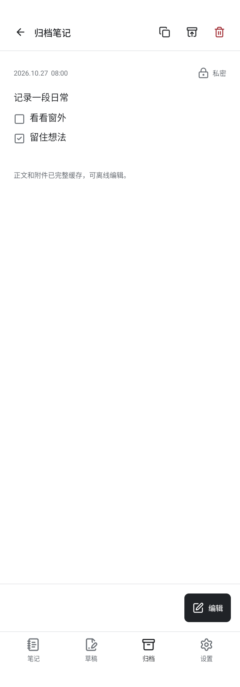
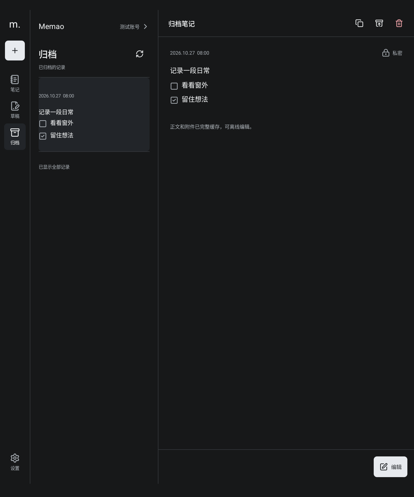
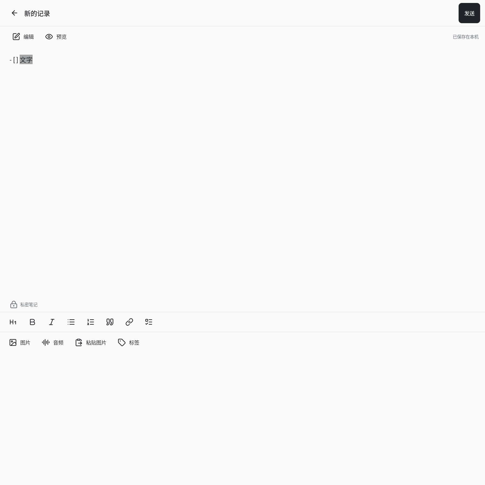
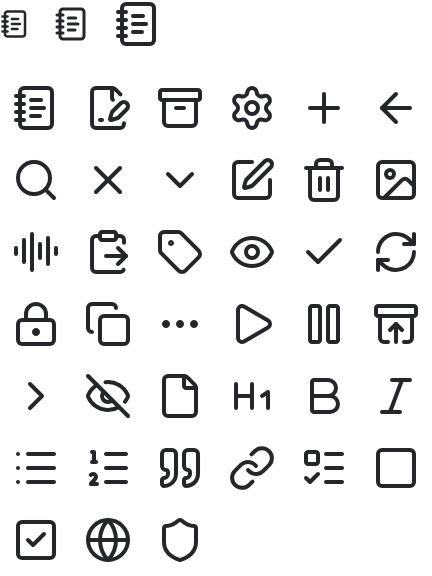
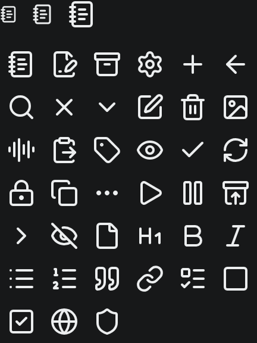
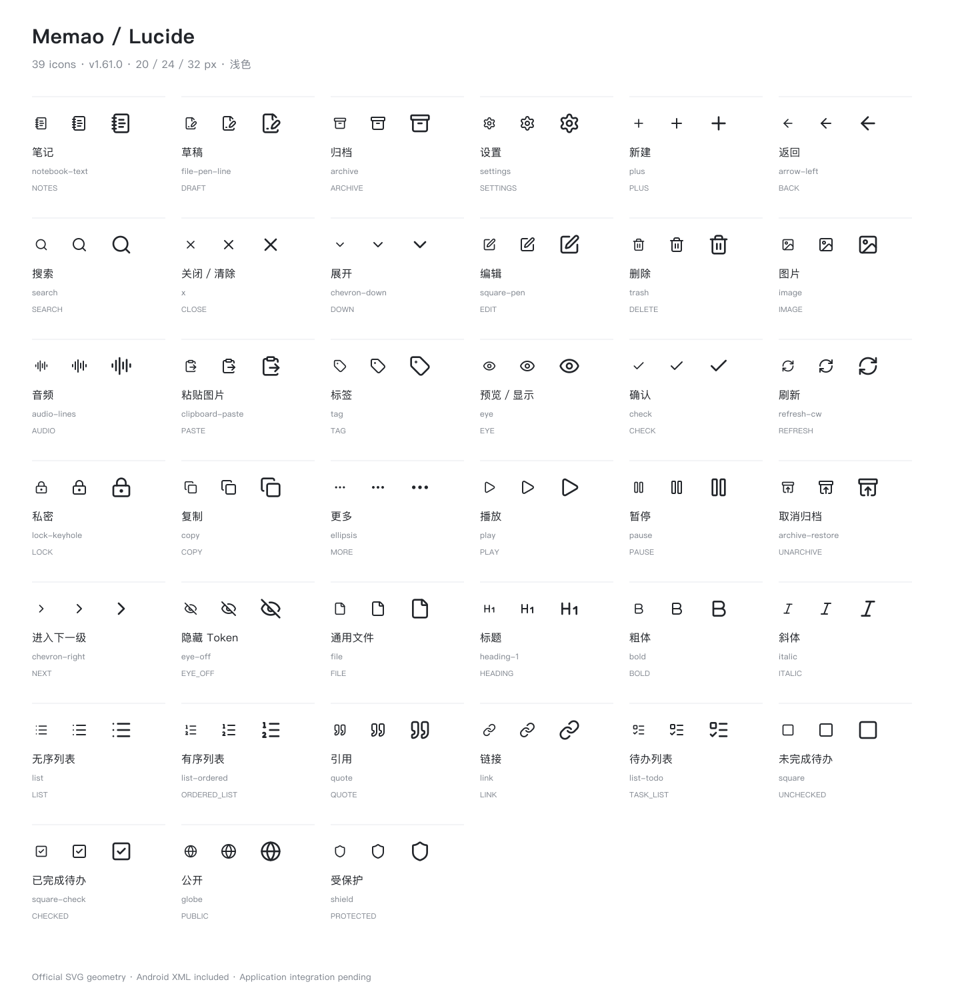
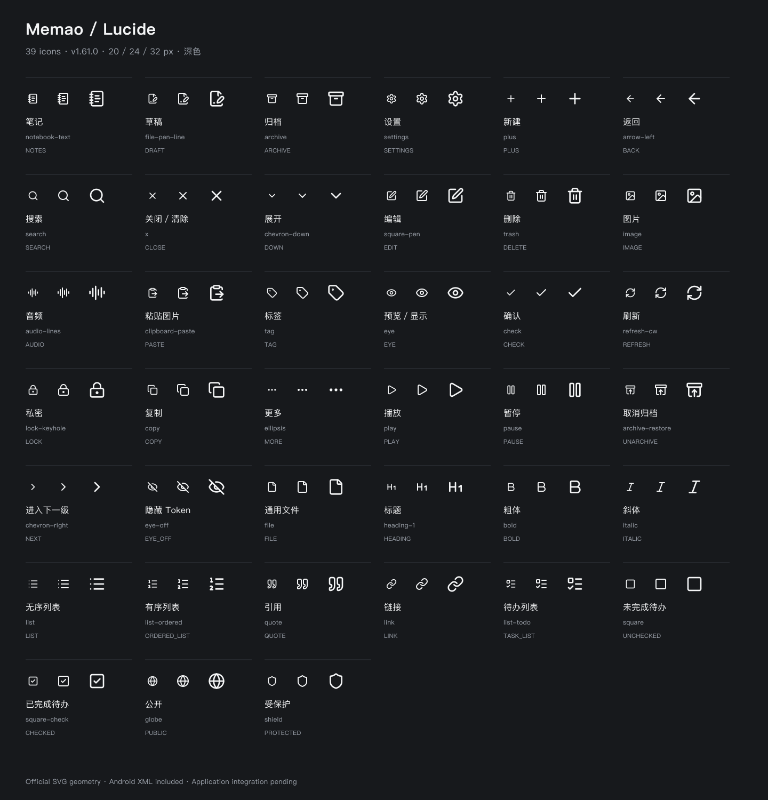

# Memao Lucide 图标优化落地方案

## 自适应抽屉图标补充 · 2026-11-06

本轮因用户要求更换导航新增 MENU → Lucide menu；沿用原固定版本 1.61.0／commit c29c276f16590cf017126671535ad8c792be64d8 与许可。当前应用内映射、SVG 和 Android 矢量合计 40 项；原 39 项交付与截图保留为历史证据。新入口继续使用 20dp 工具栏图标与至少 48dp 点击区；抽屉导航 24dp 图标加文字。完整导航规格见 [Memao 首页 UI 方案对比](home-ui-design.md)，本轮构建和界面验收见 [Memao 首版开发准备与接口核对](development-and-acceptance.md)。

版本：1.2。更新日期：2026-10-27。状态：39 项 Lucide 已完成应用内接入与替换，Memao 0.1.1 测试 APK 已生成；54 项有效自动化检查通过，主 Agent 已复核模拟器截图。Find N6／Android 16 实机验证待设备接入。

关联需求：[Memao Android 客户端需求与落地规划](planning.md)。

关联视觉：[Memao 首页 UI 方案对比](home-ui-design.md)。

开发问题统一记录：[Memao 开发问题记录](development-issues.md)。

## 替换实施与验收 · 1.2

2026-10-27：用户明确要求“完成替换”。已按本方案将 39 项 Lucide 资源接入 APP，完成全部现有图标调用点替换，并产出 Memao 0.1.1（versionCode 2）自用测试 APK。核心资源、页面接入与测试由 subagent 分工，主 Agent 审阅差异、定位问题并执行最终验证。

### 已完成的改动

- `MemaoIcons.kt` 集中维护 39 项语义映射；`LineIcon` 使用 `painterResource` 加载矢量并统一 tint，旧 Canvas 手绘路径已删除。工具栏 20dp、导航 24dp、空状态 32dp；返回及进入下一级支持 RTL 镜像。
- 完成导航、详情、编辑器、账号／设置、媒体与空状态的调用点替换。草稿、取消归档、Token 显隐、账号跳转、通用文件及可见性图标分别使用对应语义。
- 8 个 Markdown 快捷键统一为图标按钮，保留中文动作名称、48dp 触控区和原有插入逻辑。只读待办使用方框／勾选矢量，随字体缩放；修复原先读取错误 AST 层级导致待办图标未显示的问题。
- 原始 SVG、固定版本清单、SHA-256、离线生成脚本保存在 `third_party/lucide/`；39 个 XML 纳入 drawable。完整许可证保存到源码并随 APK 的 `assets/licenses/lucide-LICENSE.txt` 分发。
- 保持桌面启动图标与品牌字样，业务网络协议和数据存储实现未改动。

### 主 Agent 验证结果

有效通过项共 54 个：27 项 JVM 单元测试＋13 项 Repository 仪器测试＋8 项既有 UI／生命周期测试＋6 项新增 Lucide 仪器测试。重复运行的 6 项不重复计数。

- `assembleDebug`、`testDebugUnitTest`、`lintDebug` 完成；lint 为 0 error、33 warning，与替换前告警数量一致。
- 新增 6 项检查覆盖 Token 实际明文／掩码与动作切换、待办状态可读且只读、音频播放／暂停语义与点击区域、39 个图标深浅色实际渲染、20／24／32dp 传入尺寸、8 项格式快捷键插入且不发送，以及取消归档恢复主列表。
- 既有测试覆盖编辑内容／光标／预览跨 420dp 与 1000dp 逻辑窗口保持、音频后台暂停及仓储草稿与缓存保护。
- 6 项需要隔离服务端环境的 JVM 测试未启用；2 项可选真实服务端 UI 验收本轮未执行，不计入通过数。AGP 汇总 XML 将未启用的 LiveMedia assumption 标为 failure，但对应记录为 AssumptionViolatedException，最终构建成功；实际执行的 27 项仪器检查全部通过。另用直接 instrumentation 确认 Lucide 6 项均为 OK。
- 新 APK 已在模拟器覆盖安装成功；安装前后当时已有 3 个应用私有文件的哈希一致。这只证明当次模拟器安装保留文件，不代替用户真机完整账号／附件升级验收。
- 主 Agent 已查看下方图标总览、单列详情、双栏深色与编辑器截图，未见图标缺失、变形或裁切。原始资源重建校验与 APK 许可证内容核对通过。

0.1.1 图标专项使用 Android API 37 模拟器，目标 Find N6／Android 16 当时未连接。单双栏截图是逻辑窗口测试样本，非 Find N6 实拍；TalkBack 人工朗读、真实折叠设备与用户数据升级体验保留为设备验证项，不宣称已完成。模拟器临时屏幕尺寸与密度已恢复。

### 页面与渲染证据

单列浅色详情（420dp 逻辑窗口，包含取消归档、只读待办与底部导航）：

双栏深色详情（1000dp 逻辑窗口，左侧窄导航＋列表＋详情）：

编辑器组件截图（测试容器，展示 Markdown 与附件工具栏；不是完整折叠屏页面截图）：

39 个矢量在 Compose 中的浅色／深色实际渲染，上方另列 20／24／32dp 对照：

### 安装包与交付状态

本机 APK：`app/build/outputs/apk/debug/app-debug.apk`。另存交付副本：`Memao-0.1.1-debug.apk`。

版本：0.1.1（2）；大小：40,235,854 字节。

SHA-256：`a126398e5e30138b9179c4d3d11faa0d5779cb59b77a10daeee430bea652a58d`。

最终交付前重新打包并另存稳定副本；与模拟器已测试 APK 逐项比对，除签名元数据外的代码和资源内容一致。以上大小与哈希对应最终交付文件。

当前实现保存在工作区，基于 bb81088；本轮未创建新的 Git 提交或远程推送。源码替换和可执行验证已完成；剩余设备验证见上文。开发问题见 [Memao 开发问题记录](development-issues.md) 的 I15／I16。

## 图标素材交付 · 1.1（历史阶段）

2026-10-27：用户要求生成全部图标素材并保存到本页。已完成 39 个应用内图标的官方 SVG 整理、Android 矢量转换及深浅色预览。素材文件已随本页保存；该阶段完成素材准备，后续 APP 接入与页面替换已在上方 1.2 完成。

### 完整素材包

[memao-lucide-1.61.0-assets.zip](assets/lucide/memao-lucide-1.61.0-assets.zip)

素材包为 `memao-lucide-1.61.0-assets.zip`，共 88 个文件，328,747 字节。包含：

- `source-svg/`：39 个官方原始 SVG。
- `android-drawable/`：39 个可供后续接入的 VectorDrawable XML。
- `previews/`：浅色、深色各一份 SVG 总览和 PNG 总览；每个图标展示 20／24／32 三种尺寸。
- `gallery.html`：离线图标画廊，支持搜索、尺寸和深浅色切换；本地浏览器打开可下载单个 SVG／XML。完整素材见上方 ZIP。
- `manifest.json`：中文用途、语义标识、官方文件名、固定来源链接、SVG 与 XML 的 SHA-256。
- `LICENSE`：该版本官方完整 ISC／Feather MIT 许可声明。
- `tools/`：标准库 Python 生成脚本及使用 Sharp 的渲染／对照脚本；不带 `--fetch` 可使用包内原始 SVG 离线重新生成。
- `verification.json`：117 次尺寸转换对照结果与 39 个资源的 AAPT2 编译结果。

仓库内 ZIP SHA-256（画廊及生成脚本中的附件说明已更新）：`63f4844b8145087793c875464b116515b0a392705b3ecf37d86b68e82822e065`。

### 可交互总览

[memao-lucide-gallery.html](assets/lucide/memao-lucide-gallery.html)

### 浅色素材总览

### 深色素材总览

### 固定来源与映射修订

来源为 [Lucide 1.61.0 release](https://github.com/lucide-icons/lucide/releases/tag/1.61.0)，固定 commit：`c29c276f16590cf017126671535ad8c792be64d8`。全部 39 个原始 SVG 与 LICENSE 已逐个匹配该提交的 Git blob 哈希，保留官方图形，不采用生成式图片重新绘制。

当前集合为原有 23 项＋4 个补充动作＋8 个 Markdown 快捷项＋2 个待办状态＋2 个可见性状态，共 39 个唯一图标。

- 原建议 `music-2` 在固定版本中没有同名 SVG，音频改用 `audio-lines`，兼顾语音及其他音频。
- 原建议 `trash-2` 在固定版本中没有同名 SVG，删除采用实际存在的 `trash`。
- 补齐 `globe`／`shield` 以显示既有公开／受保护笔记；私密继续使用 `lock-keyhole`。盾牌只标记 Memos 可见性，不表示内容加密或新增安全能力。
- SVG 中少量原生填充细节（例如标签孔）保持原样；Android 中使用统一 tint 着色。

### 已完成的素材检查

- 39 个 SVG、39 个 XML 均完整；XML 全部通过 Android Build Tools 36.0.0 的 AAPT2 资源编译。
- 在相同栅格器下，将 XML 路径重建为 SVG，与原 SVG 对照 20／24／32 共 117 组。最大平均 alpha 偏差约 0.054／255；差异位于边缘抗锯齿，不代表 Android 真机像素已验证。
- 已查看深浅色总览，无缺失图标、明显形变和裁切；图标名与中文用途可读。
- 独立无头 Chrome 验证画廊显示 39 项、音频搜索命中 1 项、主题切换和单个 SVG 下载，页面无 JavaScript 错误。
- ZIP 完整性检查通过；APP 源码与资源目录未改动。实际 Compose tint、TalkBack、点击区域、目标设备和页面布局待接入后验收。

## 目标、依据与边界

用户反馈：连接自己的 Memos 服务器测试，基本功能正常；当前主要问题是 icon 质量较差。该反馈记录为用户试用结果，不等同于完整目标设备验收。

用户要求先提交当前工作区全部修改，再记录 Lucide 优化方案。本次已完成本地基线提交 `bb81088613964f3093f283eacf1b533eb886efe3`（main，`feat: implement Memao 0.1.0 Memos client`），提交后工作区干净。忽略的构建产物及本机配置未纳入版本控制；未执行远程推送。当时仅整理方案；用户随后授权生成素材并完成替换，最新实施结果见上方 1.2。

本轮目标是形成统一、可辨认、可维护的应用内图标系统，延续已认可的留白极简、黑白灰和双栏布局。采用 Lucide 已由用户指定；下文的具体图标、尺寸和工程做法为按既有授权确定的实施默认方案，可在实际视觉验收中调整。

覆盖首页导航、详情操作、编辑器、账号与设置、图片和音频控件、空状态及异常状态。桌面启动图标与应用内品牌字样属于品牌资产，另行设计，不直接替换为 Lucide 通用图标。Android 系统相册、文件选择器、键盘等系统界面不在改造范围内。

## 当前问题与代码入口

基线源码中 `ui/Components.kt` 的 `MmIcon` 共 23 个语义项，`LineIcon` 使用 Canvas 手绘路径。部分曲线通过折线近似，笔记与草稿共用图形，线宽与尺寸的关系缺少统一规则。

另有语义混用：取消归档使用刷新图标、账号行跳转使用下拉箭头、通用附件使用归档图标，Token 显隐没有成对图形。Markdown 快捷栏使用文字缩写，待办显示使用字体字符，应一并审视整体一致性。

实施入口为 `ui/Components.kt`、`ui/MemaoApp.kt`、`ui/AccountPages.kt`、`ui/Detail.kt`、`ui/Media.kt`、`ui/Feed.kt`、`ui/Editor.kt`、`ui/Markdown.kt`。既有 `MmIconButton` 的 48dp 点击区保留。

## 图标映射

| 现有语义 | Lucide 图标（已按固定版本核对并接入） | 使用规则 |
| --- | --- | --- |
| NOTES / DRAFT | notebook-text / file-pen-line | 笔记与草稿必须可区分 |
| ARCHIVE / SETTINGS | archive / settings | 归档列表与设置导航 |
| PLUS / BACK | plus / arrow-left | 新建、返回；返回随布局方向处理 |
| SEARCH / CLOSE / DOWN | search / x / chevron-down | 搜索、清除或关闭、展开下拉；标签按实际动作命名 |
| EDIT / DELETE | square-pen / trash | 编辑、删除 |
| IMAGE / AUDIO / PASTE | image / audio-lines / clipboard-paste | 相册、音频、粘贴图片 |
| TAG / EYE | tag / eye | 标签、预览；Token 显隐配合 eye-off |
| CHECK / REFRESH | check / refresh-cw | 确认或选中、刷新；不再用于取消归档 |
| LOCK / COPY / MORE | lock-keyhole / copy / ellipsis | 私密、复制、更多 |
| PLAY / PAUSE | play / pause | 音频播放状态 |
| 新增：取消归档、进入下一级 | archive-restore / chevron-right | 修正与刷新、下拉混用的语义 |
| 新增：隐藏 Token、通用文件 | eye-off / file | 分别用于显隐状态、非图片音频附件占位 |
| Markdown 快捷栏 | heading-1 / bold / italic / list / list-ordered / quote / link / list-todo | 保持现有格式能力，继续提供中文动作标签 |
| Markdown 待办显示 | square / square-check | 替换字体勾选符号，保持现有只读语义，不新增点击改写正文行为 |

以上映射已按 Lucide 1.61.0 的实际资源核对并生成，完整逐项映射见附件 manifest.json；另补齐公开 globe／受保护 shield 两项。后续扩展时优先选同库等义图标并更新映射，不现场仿画或混入另一套图标。已存在公开／受限可见性内容的显示应保留准确文字，不能让私密锁图标造成错误含义；不因此增加新建笔记可见性选择。

## 统一视觉与交互规格

- 图形保持 Lucide 原始几何与曲线，使用 24 × 24 坐标系及原始 2 单位描边、圆端点和圆连接，不凭肉眼重画。[Lucide 设计规范](https://lucide.dev/contribute/icons/design-principles)
- 工具栏与行内操作默认 20dp，主导航 24dp，空状态 32dp。描边随图形等比缩放：20dp 图标的 2 单位描边约为 1.67dp，不额外强行改成所有尺寸都 2dp。
- 外屏底部导航与展开内屏窄导航使用同一图标、尺寸和语义。大屏增加内容与留白，不把操作图标整体放大。
- 沿用主题颜色；选中、普通、禁用、危险操作分别使用集中定义的颜色状态，选中态保持同一轮廓。深浅色都检查对比度，不逐个随意调粗或填充。
- 可点击区域至少 48 × 48dp；图标居中，视觉大小与触控大小分离。设置行、工具栏不因换图标缩小点击区。
- 操作控件保留中文无障碍名称，动态更新“播放／暂停”“显示／隐藏 Token”等动作描述。装饰性图形不重复朗读；导航保留可见文字和选中语义。
- Markdown 快捷栏可用 Lucide 图形统一表现，同时保留按钮的中文说明和可访问性语义。小屏空间不足时采用现有布局允许的横向滚动，不压缩点击目标。

## Android 接入方案

采用“官方 SVG 按需纳入 → 转换为 Android VectorDrawable → Compose 统一组件加载”的方式。资源离线随包发布，不依赖运行时网络、字体图标或 PNG。VectorDrawable 是 Android 原生矢量资源格式，可导入 SVG 并按不同密度缩放。[Android 矢量资源文档](https://developer.android.com/develop/ui/views/graphics/vector-drawable-resources)

1. 从 [Lucide 官方仓库](https://github.com/lucide-icons/lucide) 已固定 release 1.61.0，对应 commit c29c276f16590cf017126671535ad8c792be64d8；本页素材以该版本生成，后续不得直接追随 main 自动更新。
2. 只纳入实际使用的 SVG，保留原始文件、来源版本、名称与转换映射。建立可重复执行的转换过程；原始文件与生成的 drawable 均纳入版本控制。校验曲线、圆、圆角矩形、描边端点和连接的转换结果，遇到不支持的 SVG 特性明确报错。
3. 生成 `ic_lucide_*.xml`；新增集中映射文件（建议 `ui/MemaoIcons.kt`）。保留业务侧 `MmIcon` 语义入口，通过 `painterResource` 加载，避免页面直接散落资源名。删除旧 Canvas 图形绘制逻辑。
4. 将尺寸默认值集中管理，调用方传入尺寸必须生效；检查空状态 32dp 不被内部 20dp 默认值覆盖。继承现有主题 tint、点击行为和 Compose 语义。
5. 增加必要语义项并修改调用点，尤其是草稿、取消归档、Token 显隐、跳转与通用附件；清点正文待办符号和 Markdown 快捷按钮，避免漏项。
6. 保留 Lucide ISC 及所含 Feather 派生资源要求的 MIT 声明；完整版权和许可文本随源码及 APK 分发，可放入现有第三方许可入口或随包 notices 资源。[Lucide 许可说明](https://lucide.dev/license)

需求、设计决策、验收结论及变更记录维护在 [项目上下文目录](README.md)。实现所用的原始矢量、转换工具、来源清单和许可证位于 [third_party/lucide/](../third_party/lucide/)，Android 矢量位于 [drawable/](../app/src/main/res/drawable/)。

## 实施顺序与交付物

### 第一步：资源定版与视觉样张

固定来源版本，完成完整映射；制作 20／24／32dp 的图标总览与浅色、深色对照。以首页、详情工具栏、编辑器、账号页、音频条和空状态制作实施前后对照，重点检查笔记／草稿辨识、曲线和视觉重量。无需重新选择图标库；常规细节按本方案推进。

交付：固定版本与许可证、资源清单、样张、必要的映射修订。

### 第二步：基础组件接入

引入按需矢量资源、转换过程、集中映射、尺寸与状态约定；保持现有按钮交互。先检查少量典型图形在 Android 上与官方 SVG 的一致性，再完成剩余资源。

交付：统一图标组件与可复现资源来源；独立代码提交，便于审阅和回退。

### 第三步：全页面替换

按导航、详情与编辑器、账号与设置、媒体与空状态逐项替换。修正语义混用，补齐动态状态与无障碍标签。保留原业务功能、数据格式、草稿保护和服务器请求行为。

交付：调用点清单逐项完成、未覆盖项说明；不把“替换了首页”当作全量完成。

### 第四步：验收与交付

主 Agent 按以下清单逐项验收。若实施阶段继续沿用此前授权的 subagent 协作，资源／组件、页面接入、检查任务应明确文件责任；同一共享文件由单一负责人修改，最终由主 Agent 集成验收。

交付：更新后的测试 APK、截图对照、验证结果和已知问题，结论同步本页；过程问题写入已有独立开发问题记录。保持同一包名和签名进行覆盖安装，以验证现有账号和草稿可继续使用。

## 验收标准

- [x] 23 个原有语义项及新增项均有明确映射；旧 Canvas 手绘图标路径全部退出使用，未混入其他图标库或字体符号作为操作图标。
- [x] 官方 SVG 与 Android 生成资源在曲线、圆角、端点、比例上匹配，无裁切、变形和明显偏心。
- [x] 笔记／草稿、刷新／取消归档、下拉／进入详情、图片／通用附件均正确区分；播放与 Token 显隐状态和动作名称对应。
- [ ] 浅色、深色下的普通、选中、禁用、危险操作状态清楚；20／24／32dp 均检查，小尺寸不糊成一团。
- [ ] Find N6／Android 16 外屏单列、内屏双栏与折叠切换检查通过；按钮不重叠、不裁切，触控区域不缩小。模拟器检查与用户实机反馈分别记录。
- [ ] TalkBack 能正确朗读操作、状态和导航选择；装饰性图标不产生重复焦点。
- [x] 编译和 lint 通过；根据实际改动运行既有 UI 测试，并对有语义变化的 Token 显隐、取消归档、播放暂停做针对性验证，不为每个资源路径编写重复实现的测试。
- [ ] Markdown 快捷键、图片和音频添加、编辑保存、账号切换保持正常；升级安装后已有账号、缓存及未发送草稿不丢失。
- [x] 原始资源、固定版本、转换映射和许可证完整；主 Agent 审阅差异确认业务数据与网络协议未被本次视觉改造意外修改。
- [x] 截图、设备验证状态和已知问题已记入项目文档；未完成项明确保留，不把样张通过当作真机通过。

## 当前待办与变更记录

- 2026-10-27：用户授权完成替换；39 项资源与调用点已接入，修复待办 AST 标记位置问题；54 项有效自动化检查通过，0.1.1 APK 与模拟器截图已交付。Find N6 实机验证保留待办。
- 2026-10-27：按用户要求生成并上传全部 39 项 SVG／Android XML、深浅色总览、交互画廊及 ZIP；版本、清单和素材级验证已完成。APP 接入、页面替换与目标设备 UI 验收仍待实施。
- 实施时记录实际 Lucide 版本、新增资源数、修改文件、验证设备与截图，并逐项更新清单。
- 2026-10-26：根据用户要求提交现有工作区，建立上述代码基线，并明确使用 Lucide 系统性优化应用内 icon。
